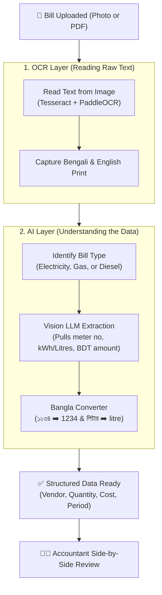
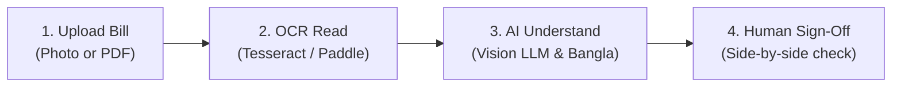

# CarbonBill: Simplified AI & OCR Workflow Diagram

> **Module:** Ingestion & Extraction (`CarbonBill.Modules.Extraction`)  
> **Engines:** Tesseract OCR, PaddleOCR (PP-OCRv4), Groq Vision LLM (`qwen/qwen3.8-27b`), and Bangla Normalizer

---

## 1. Unified AI & OCR Flowchart

This simplified diagram illustrates the end-to-end journey from a bill photo or PDF to structured, accountant-verified carbon data:

---

## 2. The 4-Step Breakdown

| Step | Component | What Happens | Real-World Benefit |
|---|---|---|---|
| **1. Upload** | Mobile PWA / Web | Staff captures utility bill; auto-saves offline in IndexedDB if no network. | Works on factory floor without reliable 4G. |
| **2. OCR (Reading)** | Base & Enhanced OCR | Runs local Tesseract; auto-escalates to PaddleOCR if the bill is blurry or faded. | $0 cloud cost for standard utility bills. |
| **3. AI (Understanding)** | Groq Vision LLM (`qwen/qwen3.8-27b`) | Extracts meter number, consumption units (kWh/L), cost (৳ BDT), and converts Bengali digits (`১২৩৪ ➡️ 1234`). | Eliminates manual accountant data entry. |
| **4. Human Sign-Off** | Review Workspace | Displays extracted values side-by-side with original photo for one-click verification. | 100% audit defensibility — zero hallucinated data. |
