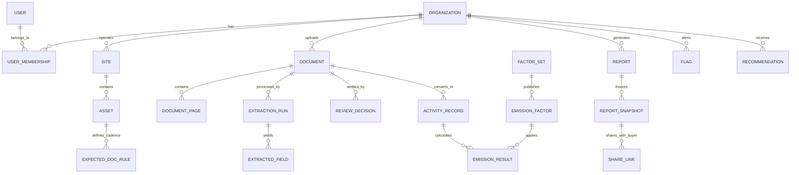
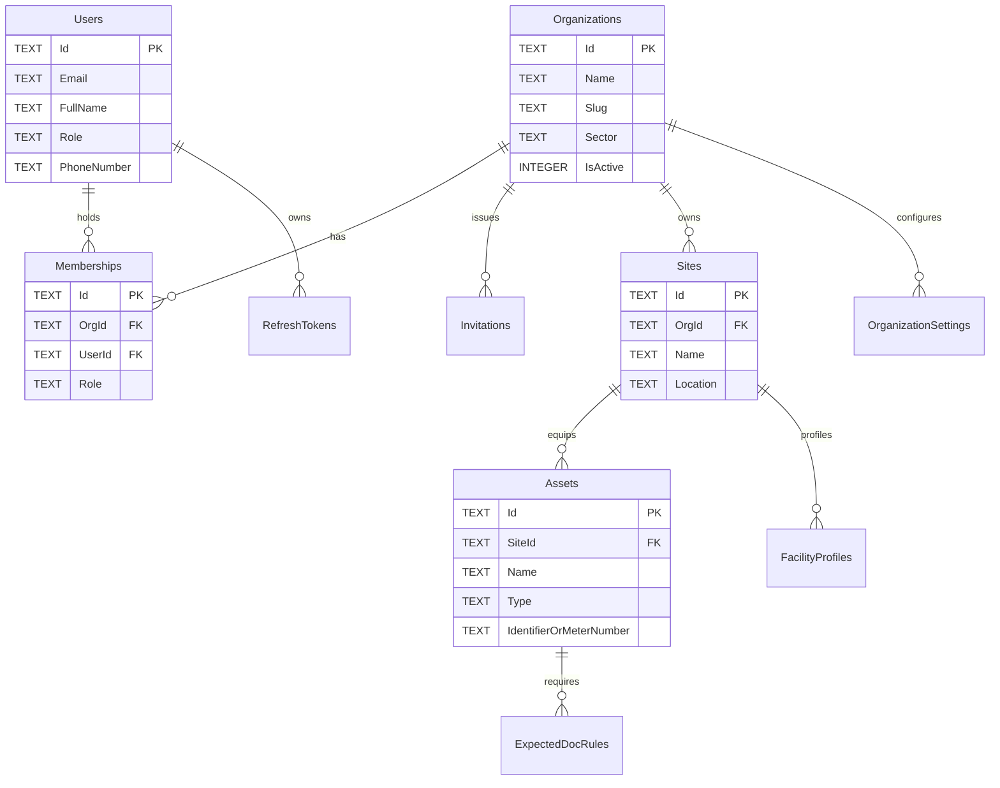
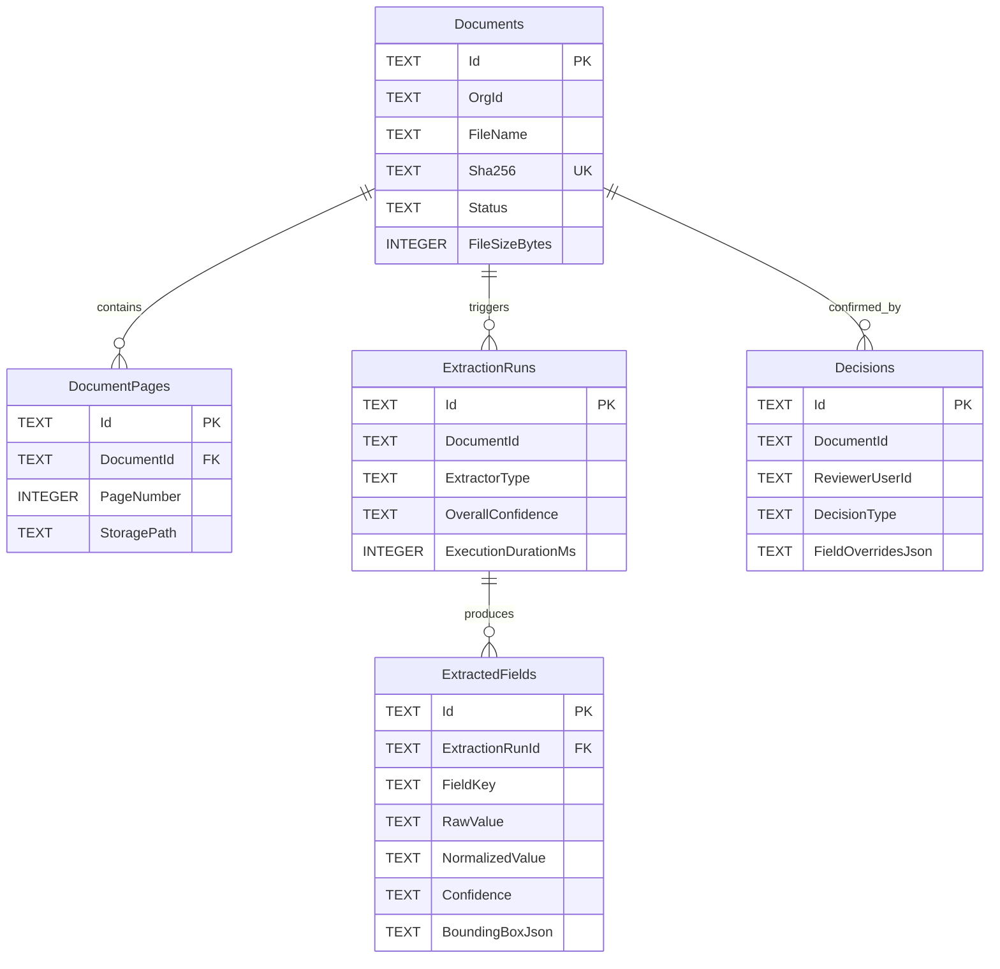
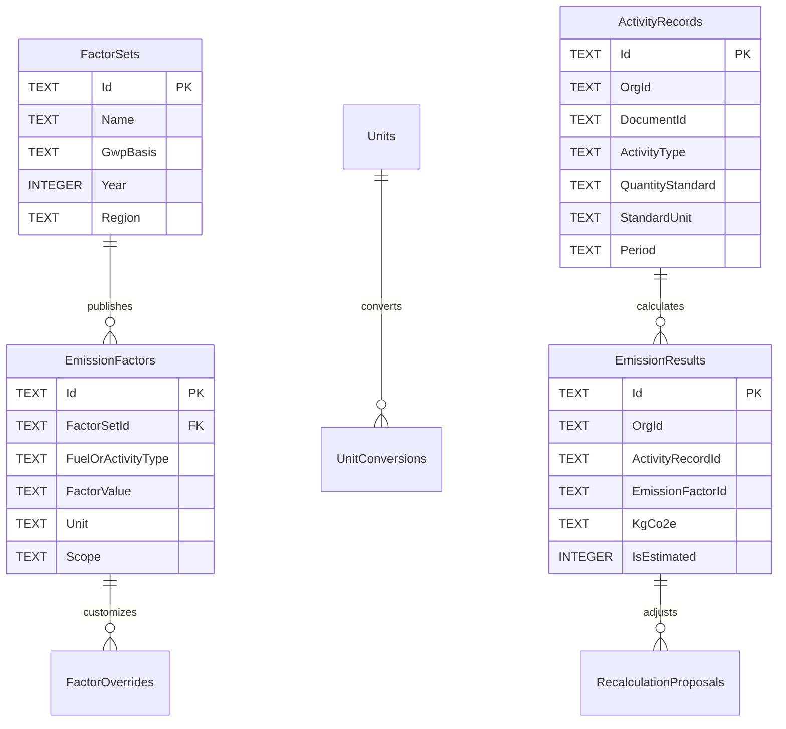
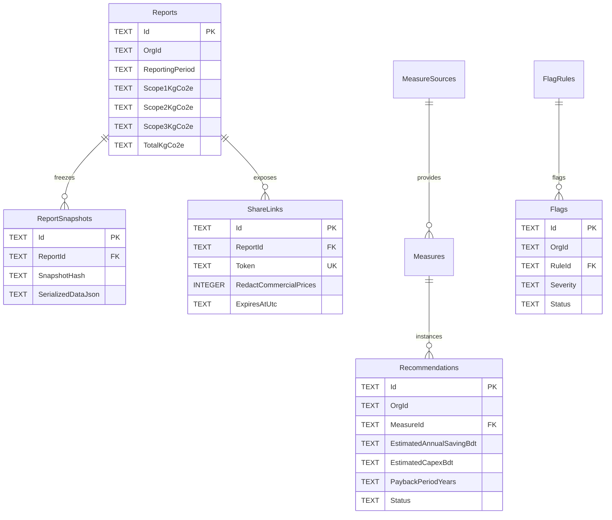

# CarbonBill: Complete Database Schema & Data Dictionary

> **Storage Engine:** SQLite 3 with Write-Ahead Logging (WAL) Mode
> **Multi-Tenancy:** EF Core Global Query Filter on `OrgId` + `TenantSaveChangesInterceptor`
> **Precision Standards:** Integer Paisa (`1 BDT = 100 Paisa`), Scaled Micro-Units (`10^6` for decimal quantities)

---

## 1. Storage & Concurrency Architecture

- **WAL PRAGMAs:** Connections enforce `PRAGMA journal_mode = WAL; PRAGMA foreign_keys = ON; PRAGMA busy_timeout = 5000; PRAGMA synchronous = NORMAL;`.
- **Concurrency Resilience:** `SqliteLockRetryMiddleware` catches `SQLITE_BUSY` (code 5) and applies exponential backoff with jitter.
- **Modular Isolation:** Cross-module references use logical IDs (`Guid`) rather than database-level hard foreign keys to guarantee decoupled modular monolith boundaries.
- **Automated Backups:** Hangfire nightly cron executes `VACUUM INTO` and uploads encrypted database snapshots to object storage.

---

## 2. High-Level Entity Relationship Overview

---

## 3. Module-by-Module Entity Relationship Diagrams

### 3.1 Identity, Tenancy & Onboarding Schema

---

### 3.2 Documents, Extraction & Review Workspace Schema

---

### 3.3 Carbon Accounting, Factor Registry & Calculations Schema

---

### 3.4 Reporting, Recommendations & Compliance Verification Schema

---

## 4. Comprehensive 41-Table Data Dictionary

### Identity & Tenancy
*Manages organizations, user accounts, role memberships (Owner, Accountant, Compliance, FloorStaff, Admin), invitations, and JWT refresh tokens.*

#### Table: `Organizations`
| Column Name | SQLite Type | Nullable | Key | Foreign Key / Reference | Description |
|---|---|---|---|---|---|
| `Id` | `TEXT` | NO | **PK** |  | Unique identifier (UUID string / GUID) |
| `Name` | `TEXT` | NO |  |  | Display / friendly name |
| `Slug` | `TEXT` | NO |  |  | Domain attribute: Slug |
| `Sector` | `TEXT` | NO |  |  | Domain attribute: Sector |
| `IsActive` | `INTEGER` | NO |  |  | Active flag boolean (1 = active, 0 = inactive) |
| `CreatedAtUtc` | `TEXT` | NO |  |  | Record creation timestamp in ISO-8601 UTC |
| `UpdatedAtUtc` | `TEXT` | YES |  |  | Record last modification timestamp in ISO-8601 UTC |

#### Table: `Users`
| Column Name | SQLite Type | Nullable | Key | Foreign Key / Reference | Description |
|---|---|---|---|---|---|
| `Id` | `TEXT` | NO | **PK** |  | Unique identifier (UUID string / GUID) |
| `Email` | `TEXT` | NO |  |  | Email address (unique account identifier) |
| `FullName` | `TEXT` | NO |  |  | Domain attribute: FullName |
| `PasswordHash` | `TEXT` | NO |  |  | Domain attribute: PasswordHash |
| `PhoneNumber` | `TEXT` | YES |  |  | Domain attribute: PhoneNumber |
| `PreferredLanguage` | `TEXT` | NO |  |  | Domain attribute: PreferredLanguage |
| `IsActive` | `INTEGER` | NO |  |  | Active flag boolean (1 = active, 0 = inactive) |
| `CreatedAtUtc` | `TEXT` | NO |  |  | Record creation timestamp in ISO-8601 UTC |
| `UpdatedAtUtc` | `TEXT` | YES |  |  | Record last modification timestamp in ISO-8601 UTC |
| `PasswordResetTokenHash` | `TEXT` | YES |  |  | Domain attribute: PasswordResetTokenHash |
| `PasswordResetExpiresAtUtc` | `TEXT` | YES |  |  | Timestamp in UTC ISO-8601 |
| `Role` | `TEXT` | YES |  |  | Persona / security role (Owner, Accountant, Compliance, FloorStaff, Admin) |

#### Table: `Memberships`
| Column Name | SQLite Type | Nullable | Key | Foreign Key / Reference | Description |
|---|---|---|---|---|---|
| `Id` | `TEXT` | NO | **PK** |  | Unique identifier (UUID string / GUID) |
| `UserId` | `TEXT` | NO |  | Users.Id | User reference identifier |
| `OrgId` | `TEXT` | NO |  | Organizations.Id | Tenant scope identifier referencing Organizations.Id |
| `IsActive` | `INTEGER` | NO |  |  | Active flag boolean (1 = active, 0 = inactive) |
| `CreatedAtUtc` | `TEXT` | NO |  |  | Record creation timestamp in ISO-8601 UTC |
| `UpdatedAtUtc` | `TEXT` | YES |  |  | Record last modification timestamp in ISO-8601 UTC |
| `Role` | `TEXT` | YES |  |  | Persona / security role (Owner, Accountant, Compliance, FloorStaff, Admin) |

#### Table: `Invitations`
| Column Name | SQLite Type | Nullable | Key | Foreign Key / Reference | Description |
|---|---|---|---|---|---|
| `Id` | `TEXT` | NO | **PK** |  | Unique identifier (UUID string / GUID) |
| `OrgId` | `TEXT` | NO |  | Organizations.Id | Tenant scope identifier referencing Organizations.Id |
| `Token` | `TEXT` | NO |  |  | Domain attribute: Token |
| `ExpiresAtUtc` | `TEXT` | NO |  |  | Timestamp in UTC ISO-8601 |
| `CreatedByUserId` | `TEXT` | NO |  |  | Reference identifier to CreatedByUser |
| `IsRevoked` | `INTEGER` | NO |  |  | Boolean flag (1 = true, 0 = false) |
| `MaxUses` | `INTEGER` | NO |  |  | Domain attribute: MaxUses |
| `UseCount` | `INTEGER` | NO |  |  | Domain attribute: UseCount |
| `UsedByUserId` | `TEXT` | YES |  |  | Reference identifier to UsedByUser |
| `UsedAtUtc` | `TEXT` | YES |  |  | Timestamp in UTC ISO-8601 |
| `CreatedAtUtc` | `TEXT` | NO |  |  | Record creation timestamp in ISO-8601 UTC |
| `UpdatedAtUtc` | `TEXT` | YES |  |  | Record last modification timestamp in ISO-8601 UTC |
| `InvitedEmail` | `TEXT` | YES |  |  | Domain attribute: InvitedEmail |

#### Table: `RefreshTokens`
| Column Name | SQLite Type | Nullable | Key | Foreign Key / Reference | Description |
|---|---|---|---|---|---|
| `Id` | `TEXT` | NO | **PK** |  | Unique identifier (UUID string / GUID) |
| `UserId` | `TEXT` | NO |  | Users.Id | User reference identifier |
| `TokenHash` | `TEXT` | NO |  |  | Domain attribute: TokenHash |
| `ExpiresAtUtc` | `TEXT` | NO |  |  | Timestamp in UTC ISO-8601 |
| `RevokedAtUtc` | `TEXT` | YES |  |  | Timestamp in UTC ISO-8601 |
| `CreatedAtUtc` | `TEXT` | NO |  |  | Record creation timestamp in ISO-8601 UTC |
| `UpdatedAtUtc` | `TEXT` | YES |  |  | Record last modification timestamp in ISO-8601 UTC |

### Onboarding & Assets
*Defines organizational hierarchy, factory sites, physical assets (meters, generators, boilers), expected billing cadence rules, and facility profiles.*

#### Table: `Sites`
| Column Name | SQLite Type | Nullable | Key | Foreign Key / Reference | Description |
|---|---|---|---|---|---|
| `Id` | `TEXT` | NO | **PK** |  | Unique identifier (UUID string / GUID) |
| `OrgId` | `TEXT` | NO |  |  | Tenant scope identifier referencing Organizations.Id |
| `Name` | `TEXT` | NO |  |  | Display / friendly name |
| `Address` | `TEXT` | YES |  |  | Domain attribute: Address |
| `City` | `TEXT` | YES |  |  | Domain attribute: City |
| `IsPrimary` | `INTEGER` | NO |  |  | Boolean flag (1 = true, 0 = false) |
| `CreatedAtUtc` | `TEXT` | NO |  |  | Record creation timestamp in ISO-8601 UTC |
| `UpdatedAtUtc` | `TEXT` | YES |  |  | Record last modification timestamp in ISO-8601 UTC |

#### Table: `Assets`
| Column Name | SQLite Type | Nullable | Key | Foreign Key / Reference | Description |
|---|---|---|---|---|---|
| `Id` | `TEXT` | NO | **PK** |  | Unique identifier (UUID string / GUID) |
| `OrgId` | `TEXT` | NO |  |  | Tenant scope identifier referencing Organizations.Id |
| `SiteId` | `TEXT` | NO |  | Sites.Id | Factory facility reference identifier referencing Sites.Id |
| `Type` | `TEXT` | NO |  |  | Domain attribute: Type |
| `Name` | `TEXT` | NO |  |  | Display / friendly name |
| `IdentifierOrMeterNumber` | `TEXT` | YES |  |  | Domain attribute: IdentifierOrMeterNumber |
| `FuelOrEnergyType` | `TEXT` | YES |  |  | Domain attribute: FuelOrEnergyType |
| `CreatedAtUtc` | `TEXT` | NO |  |  | Record creation timestamp in ISO-8601 UTC |
| `UpdatedAtUtc` | `TEXT` | YES |  |  | Record last modification timestamp in ISO-8601 UTC |

#### Table: `ExpectedDocRules`
| Column Name | SQLite Type | Nullable | Key | Foreign Key / Reference | Description |
|---|---|---|---|---|---|
| `Id` | `TEXT` | NO | **PK** |  | Unique identifier (UUID string / GUID) |
| `OrgId` | `TEXT` | NO |  |  | Tenant scope identifier referencing Organizations.Id |
| `AssetId` | `TEXT` | NO |  | Assets.Id | Physical asset/meter reference referencing Assets.Id |
| `DocType` | `TEXT` | NO |  |  | Domain attribute: DocType |
| `Frequency` | `TEXT` | NO |  |  | Domain attribute: Frequency |
| `DueDayOfMonth` | `INTEGER` | NO |  |  | Domain attribute: DueDayOfMonth |
| `ResponsibleUserId` | `TEXT` | YES |  |  | Reference identifier to ResponsibleUser |
| `IsActive` | `INTEGER` | NO |  |  | Active flag boolean (1 = active, 0 = inactive) |
| `CreatedAtUtc` | `TEXT` | NO |  |  | Record creation timestamp in ISO-8601 UTC |
| `UpdatedAtUtc` | `TEXT` | YES |  |  | Record last modification timestamp in ISO-8601 UTC |

#### Table: `FacilityProfiles`
| Column Name | SQLite Type | Nullable | Key | Foreign Key / Reference | Description |
|---|---|---|---|---|---|
| `Id` | `TEXT` | NO | **PK** |  | Unique identifier (UUID string / GUID) |
| `OrgId` | `TEXT` | NO |  |  | Tenant scope identifier referencing Organizations.Id |
| `HasBoiler` | `INTEGER` | NO |  |  | Domain attribute: HasBoiler |
| `HasGenset` | `INTEGER` | NO |  |  | Domain attribute: HasGenset |
| `RoofAreaSqFt` | `TEXT` | NO |  |  | Domain attribute: RoofAreaSqFt |
| `BuildingOwnership` | `TEXT` | NO |  |  | Domain attribute: BuildingOwnership |
| `BudgetBandBdt` | `TEXT` | NO |  |  | Amount in Bangladeshi Taka (Paisa or Scaled) |
| `AnnualProductionVolume` | `TEXT` | YES |  |  | Domain attribute: AnnualProductionVolume |
| `ProductionUnit` | `TEXT` | YES |  |  | Domain attribute: ProductionUnit |
| `CreatedAtUtc` | `TEXT` | NO |  |  | Record creation timestamp in ISO-8601 UTC |
| `UpdatedAtUtc` | `TEXT` | YES |  |  | Record last modification timestamp in ISO-8601 UTC |

#### Table: `OrganizationSettings`
| Column Name | SQLite Type | Nullable | Key | Foreign Key / Reference | Description |
|---|---|---|---|---|---|
| `Id` | `TEXT` | NO | **PK** |  | Unique identifier (UUID string / GUID) |
| `OrgId` | `TEXT` | NO |  |  | Tenant scope identifier referencing Organizations.Id |
| `AutoConfirmEnabled` | `INTEGER` | NO |  |  | Domain attribute: AutoConfirmEnabled |
| `AutoConfirmThreshold` | `REAL` | NO |  |  | Domain attribute: AutoConfirmThreshold |
| `ManualConfirmCount` | `INTEGER` | NO |  |  | Domain attribute: ManualConfirmCount |
| `SamplingRate` | `REAL` | NO |  |  | Domain attribute: SamplingRate |
| `CreatedAtUtc` | `TEXT` | NO |  |  | Record creation timestamp in ISO-8601 UTC |
| `UpdatedAtUtc` | `TEXT` | YES |  |  | Record last modification timestamp in ISO-8601 UTC |

### Documents & Storage
*Handles multi-page document uploads, SHA-256 deduplication hashing, and object storage file paths.*

#### Table: `Documents`
| Column Name | SQLite Type | Nullable | Key | Foreign Key / Reference | Description |
|---|---|---|---|---|---|
| `Id` | `TEXT` | NO | **PK** |  | Unique identifier (UUID string / GUID) |
| `OrgId` | `TEXT` | NO |  |  | Tenant scope identifier referencing Organizations.Id |
| `SiteId` | `TEXT` | YES |  |  | Factory facility reference identifier referencing Sites.Id |
| `AssetId` | `TEXT` | YES |  |  | Physical asset/meter reference referencing Assets.Id |
| `FileName` | `TEXT` | NO |  |  | Domain attribute: FileName |
| `StoragePath` | `TEXT` | NO |  |  | File storage URI / bucket path in Cloudflare R2 or local disk |
| `ContentType` | `TEXT` | NO |  |  | Domain attribute: ContentType |
| `FileSizeBytes` | `INTEGER` | NO |  |  | Domain attribute: FileSizeBytes |
| `Sha256Hash` | `TEXT` | NO |  |  | Domain attribute: Sha256Hash |
| `Status` | `TEXT` | NO |  |  | Lifecycle status string |
| `Source` | `TEXT` | NO |  |  | Domain attribute: Source |
| `CapturedAtUtc` | `TEXT` | NO |  |  | Timestamp in UTC ISO-8601 |
| `TierUsed` | `INTEGER` | YES |  |  | Domain attribute: TierUsed |
| `IsEstimated` | `INTEGER` | NO |  |  | Boolean flag (1 = true, 0 = false) |
| `UploadedByUserId` | `TEXT` | NO |  |  | Reference identifier to UploadedByUser |
| `ClientIdempotencyKey` | `TEXT` | YES |  |  | Domain attribute: ClientIdempotencyKey |
| `DocType` | `TEXT` | YES |  |  | Domain attribute: DocType |
| `FailureReason` | `TEXT` | YES |  |  | Domain attribute: FailureReason |
| `CreatedAtUtc` | `TEXT` | NO |  |  | Record creation timestamp in ISO-8601 UTC |
| `UpdatedAtUtc` | `TEXT` | YES |  |  | Record last modification timestamp in ISO-8601 UTC |

#### Table: `DocumentPages`
| Column Name | SQLite Type | Nullable | Key | Foreign Key / Reference | Description |
|---|---|---|---|---|---|
| `Id` | `TEXT` | NO | **PK** |  | Unique identifier (UUID string / GUID) |
| `DocumentId` | `TEXT` | NO |  | Documents.Id | Source document reference referencing Documents.Id |
| `PageNumber` | `INTEGER` | NO |  |  | Domain attribute: PageNumber |
| `StoragePath` | `TEXT` | NO |  |  | File storage URI / bucket path in Cloudflare R2 or local disk |
| `CreatedAtUtc` | `TEXT` | NO |  |  | Record creation timestamp in ISO-8601 UTC |
| `UpdatedAtUtc` | `TEXT` | YES |  |  | Record last modification timestamp in ISO-8601 UTC |

### Extraction & OCR
*Orchestrates multi-tier OCR and vision LLM extraction runs, raw field parsing, normalized values, confidence scores, and bounding boxes.*

#### Table: `ExtractionRuns`
| Column Name | SQLite Type | Nullable | Key | Foreign Key / Reference | Description |
|---|---|---|---|---|---|
| `Id` | `TEXT` | NO | **PK** |  | Unique identifier (UUID string / GUID) |
| `OrgId` | `TEXT` | NO |  |  | Tenant scope identifier referencing Organizations.Id |
| `DocumentId` | `TEXT` | NO |  |  | Source document reference referencing Documents.Id |
| `TierUsed` | `INTEGER` | NO |  |  | Domain attribute: TierUsed |
| `Status` | `TEXT` | NO |  |  | Lifecycle status string |
| `OverallConfidence` | `REAL` | NO |  |  | Domain attribute: OverallConfidence |
| `RawOutputJson` | `TEXT` | YES |  |  | Serialized JSON payload |
| `ProcessedAtUtc` | `TEXT` | NO |  |  | Timestamp in UTC ISO-8601 |
| `CreatedAtUtc` | `TEXT` | NO |  |  | Record creation timestamp in ISO-8601 UTC |
| `UpdatedAtUtc` | `TEXT` | YES |  |  | Record last modification timestamp in ISO-8601 UTC |

#### Table: `ExtractedFields`
| Column Name | SQLite Type | Nullable | Key | Foreign Key / Reference | Description |
|---|---|---|---|---|---|
| `Id` | `TEXT` | NO | **PK** |  | Unique identifier (UUID string / GUID) |
| `OrgId` | `TEXT` | NO |  |  | Tenant scope identifier referencing Organizations.Id |
| `ExtractionRunId` | `TEXT` | NO |  | ExtractionRuns.Id | Reference identifier to ExtractionRun |
| `DocumentId` | `TEXT` | NO |  |  | Source document reference referencing Documents.Id |
| `FieldName` | `TEXT` | NO |  |  | Domain attribute: FieldName |
| `RawValue` | `TEXT` | NO |  |  | Domain attribute: RawValue |
| `NormalizedValue` | `TEXT` | YES |  |  | Domain attribute: NormalizedValue |
| `CorrectedValue` | `TEXT` | YES |  |  | Domain attribute: CorrectedValue |
| `Confidence` | `REAL` | NO |  |  | Mathematical confidence score (0.00 to 1.00) |
| `SourceTier` | `INTEGER` | NO |  |  | Domain attribute: SourceTier |
| `BoundingBoxJson` | `TEXT` | YES |  |  | Serialized JSON payload |
| `CreatedAtUtc` | `TEXT` | NO |  |  | Record creation timestamp in ISO-8601 UTC |
| `UpdatedAtUtc` | `TEXT` | YES |  |  | Record last modification timestamp in ISO-8601 UTC |

### Review & Verification
*Tracks accountant verification decisions, manual field corrections, rejection reasons, and reviewer audit stamps.*

#### Table: `Decisions`
| Column Name | SQLite Type | Nullable | Key | Foreign Key / Reference | Description |
|---|---|---|---|---|---|
| `Id` | `TEXT` | NO | **PK** |  | Unique identifier (UUID string / GUID) |
| `OrgId` | `TEXT` | NO |  |  | Tenant scope identifier referencing Organizations.Id |
| `DocumentId` | `TEXT` | NO |  |  | Source document reference referencing Documents.Id |
| `ReviewerUserId` | `TEXT` | NO |  |  | Reference identifier to ReviewerUser |
| `Mode` | `TEXT` | NO |  |  | Domain attribute: Mode |
| `Decision` | `TEXT` | NO |  |  | Domain attribute: Decision |
| `Notes` | `TEXT` | YES |  |  | Domain attribute: Notes |
| `DecidedAtUtc` | `TEXT` | NO |  |  | Timestamp in UTC ISO-8601 |
| `CreatedAtUtc` | `TEXT` | NO |  |  | Record creation timestamp in ISO-8601 UTC |
| `UpdatedAtUtc` | `TEXT` | YES |  |  | Record last modification timestamp in ISO-8601 UTC |

### Activity Units & Conversions
*Maintains canonical activity units (kWh, litre, kg, m3, GJ), mathematical conversion factors, and normalized consumption activity records.*

#### Table: `Units`
| Column Name | SQLite Type | Nullable | Key | Foreign Key / Reference | Description |
|---|---|---|---|---|---|
| `Id` | `TEXT` | NO | **PK** |  | Unique identifier (UUID string / GUID) |
| `Code` | `TEXT` | NO |  |  | Domain attribute: Code |
| `NameEn` | `TEXT` | NO |  |  | Domain attribute: NameEn |
| `NameBn` | `TEXT` | NO |  |  | Domain attribute: NameBn |
| `PhysicalQuantity` | `TEXT` | NO |  |  | Domain attribute: PhysicalQuantity |
| `CreatedAtUtc` | `TEXT` | NO |  |  | Record creation timestamp in ISO-8601 UTC |
| `UpdatedAtUtc` | `TEXT` | YES |  |  | Record last modification timestamp in ISO-8601 UTC |

#### Table: `UnitConversions`
| Column Name | SQLite Type | Nullable | Key | Foreign Key / Reference | Description |
|---|---|---|---|---|---|
| `Id` | `TEXT` | NO | **PK** |  | Unique identifier (UUID string / GUID) |
| `FromUnit` | `TEXT` | NO |  |  | Domain attribute: FromUnit |
| `ToUnit` | `TEXT` | NO |  |  | Domain attribute: ToUnit |
| `ConversionFactor` | `TEXT` | NO |  |  | Domain attribute: ConversionFactor |
| `Version` | `INTEGER` | NO |  |  | Domain attribute: Version |
| `CreatedAtUtc` | `TEXT` | NO |  |  | Record creation timestamp in ISO-8601 UTC |
| `UpdatedAtUtc` | `TEXT` | YES |  |  | Record last modification timestamp in ISO-8601 UTC |

#### Table: `ActivityRecords`
| Column Name | SQLite Type | Nullable | Key | Foreign Key / Reference | Description |
|---|---|---|---|---|---|
| `Id` | `TEXT` | NO | **PK** |  | Unique identifier (UUID string / GUID) |
| `OrgId` | `TEXT` | NO |  |  | Tenant scope identifier referencing Organizations.Id |
| `SiteId` | `TEXT` | YES |  |  | Factory facility reference identifier referencing Sites.Id |
| `AssetId` | `TEXT` | YES |  |  | Physical asset/meter reference referencing Assets.Id |
| `DocumentId` | `TEXT` | NO |  |  | Source document reference referencing Documents.Id |
| `ActivityType` | `TEXT` | NO |  |  | Domain attribute: ActivityType |
| `QuantityStandard` | `TEXT` | NO |  |  | Domain attribute: QuantityStandard |
| `StandardUnit` | `TEXT` | NO |  |  | Domain attribute: StandardUnit |
| `RawQuantity` | `TEXT` | NO |  |  | Domain attribute: RawQuantity |
| `RawUnit` | `TEXT` | NO |  |  | Domain attribute: RawUnit |
| `TotalCostBdt` | `TEXT` | YES |  |  | Amount in Bangladeshi Taka (Paisa or Scaled) |
| `UnitCostBdt` | `TEXT` | YES |  |  | Amount in Bangladeshi Taka (Paisa or Scaled) |
| `Period` | `TEXT` | NO |  |  | Domain attribute: Period |
| `IsEstimated` | `INTEGER` | NO |  |  | Boolean flag (1 = true, 0 = false) |
| `CreatedAtUtc` | `TEXT` | NO |  |  | Record creation timestamp in ISO-8601 UTC |
| `UpdatedAtUtc` | `TEXT` | YES |  |  | Record last modification timestamp in ISO-8601 UTC |

### Emission Factor Registry
*Versioned emission factor datasets (National Grid 2024, IPCC AR6, UK DEFRA) and tenant-specific overrides with formal justifications.*

#### Table: `FactorSets`
| Column Name | SQLite Type | Nullable | Key | Foreign Key / Reference | Description |
|---|---|---|---|---|---|
| `Id` | `TEXT` | NO | **PK** |  | Unique identifier (UUID string / GUID) |
| `Name` | `TEXT` | NO |  |  | Display / friendly name |
| `GwpBasis` | `TEXT` | NO |  |  | Domain attribute: GwpBasis |
| `SourceCitation` | `TEXT` | NO |  |  | Domain attribute: SourceCitation |
| `Year` | `INTEGER` | NO |  |  | Domain attribute: Year |
| `Region` | `TEXT` | NO |  |  | Domain attribute: Region |
| `Version` | `INTEGER` | NO |  |  | Domain attribute: Version |
| `ValidFrom` | `TEXT` | NO |  |  | Domain attribute: ValidFrom |
| `ValidTo` | `TEXT` | YES |  |  | Domain attribute: ValidTo |
| `IsPublished` | `INTEGER` | NO |  |  | Boolean flag (1 = true, 0 = false) |
| `CreatedAtUtc` | `TEXT` | NO |  |  | Record creation timestamp in ISO-8601 UTC |
| `UpdatedAtUtc` | `TEXT` | YES |  |  | Record last modification timestamp in ISO-8601 UTC |

#### Table: `EmissionFactors`
| Column Name | SQLite Type | Nullable | Key | Foreign Key / Reference | Description |
|---|---|---|---|---|---|
| `Id` | `TEXT` | NO | **PK** |  | Unique identifier (UUID string / GUID) |
| `FactorSetId` | `TEXT` | NO |  | FactorSets.Id | Reference identifier to FactorSet |
| `ActivityType` | `TEXT` | NO |  |  | Domain attribute: ActivityType |
| `FuelOrMode` | `TEXT` | NO |  |  | Domain attribute: FuelOrMode |
| `Unit` | `TEXT` | NO |  |  | Domain attribute: Unit |
| `Co2eFactor` | `TEXT` | NO |  |  | Domain attribute: Co2eFactor |
| `Scope` | `INTEGER` | NO |  |  | Domain attribute: Scope |
| `Tier` | `TEXT` | YES |  |  | Extraction engine tier used (1 = Tesseract, 2 = Azure DI, 3 = Vision LLM) |
| `Notes` | `TEXT` | YES |  |  | Domain attribute: Notes |
| `CreatedAtUtc` | `TEXT` | NO |  |  | Record creation timestamp in ISO-8601 UTC |
| `UpdatedAtUtc` | `TEXT` | YES |  |  | Record last modification timestamp in ISO-8601 UTC |

#### Table: `FactorOverrides`
| Column Name | SQLite Type | Nullable | Key | Foreign Key / Reference | Description |
|---|---|---|---|---|---|
| `Id` | `TEXT` | NO | **PK** |  | Unique identifier (UUID string / GUID) |
| `OrgId` | `TEXT` | NO |  |  | Tenant scope identifier referencing Organizations.Id |
| `EmissionFactorId` | `TEXT` | NO |  | EmissionFactors.Id | Reference identifier to EmissionFactor |
| `OverrideValue` | `TEXT` | NO |  |  | Domain attribute: OverrideValue |
| `Justification` | `TEXT` | NO |  |  | Domain attribute: Justification |
| `ApprovedByUserId` | `TEXT` | NO |  |  | Reference identifier to ApprovedByUser |
| `ApprovedAtUtc` | `TEXT` | NO |  |  | Timestamp in UTC ISO-8601 |
| `IsActive` | `INTEGER` | NO |  |  | Active flag boolean (1 = active, 0 = inactive) |
| `CreatedAtUtc` | `TEXT` | NO |  |  | Record creation timestamp in ISO-8601 UTC |
| `UpdatedAtUtc` | `TEXT` | YES |  |  | Record last modification timestamp in ISO-8601 UTC |

### Calculation & GHG Accounting
*Stores calculated Scope 1, Scope 2, and Scope 3 kg CO2e results tied to specific factor versions, and tracks recalculation proposals.*

#### Table: `EmissionResults`
| Column Name | SQLite Type | Nullable | Key | Foreign Key / Reference | Description |
|---|---|---|---|---|---|
| `Id` | `TEXT` | NO | **PK** |  | Unique identifier (UUID string / GUID) |
| `OrgId` | `TEXT` | NO |  |  | Tenant scope identifier referencing Organizations.Id |
| `ActivityRecordId` | `TEXT` | NO |  |  | Reference identifier to ActivityRecord |
| `DocumentId` | `TEXT` | NO |  |  | Source document reference referencing Documents.Id |
| `FactorId` | `TEXT` | NO |  |  | Reference identifier to Factor |
| `FactorVersion` | `INTEGER` | NO |  |  | Domain attribute: FactorVersion |
| `ConversionVersion` | `INTEGER` | NO |  |  | Domain attribute: ConversionVersion |
| `Scope` | `INTEGER` | NO |  |  | Domain attribute: Scope |
| `Category` | `TEXT` | NO |  |  | Domain attribute: Category |
| `QuantityStandard` | `TEXT` | NO |  |  | Domain attribute: QuantityStandard |
| `StandardUnit` | `TEXT` | NO |  |  | Domain attribute: StandardUnit |
| `EmissionFactorUsed` | `TEXT` | NO |  |  | Domain attribute: EmissionFactorUsed |
| `KgCo2e` | `TEXT` | NO |  |  | Calculated carbon footprint in kilograms of CO2 equivalent |
| `Period` | `TEXT` | NO |  |  | Domain attribute: Period |
| `IsEstimated` | `INTEGER` | NO |  |  | Boolean flag (1 = true, 0 = false) |
| `CalculatedAtUtc` | `TEXT` | NO |  |  | Timestamp in UTC ISO-8601 |
| `CreatedAtUtc` | `TEXT` | NO |  |  | Record creation timestamp in ISO-8601 UTC |
| `UpdatedAtUtc` | `TEXT` | YES |  |  | Record last modification timestamp in ISO-8601 UTC |

#### Table: `RecalculationProposals`
| Column Name | SQLite Type | Nullable | Key | Foreign Key / Reference | Description |
|---|---|---|---|---|---|
| `Id` | `TEXT` | NO | **PK** |  | Unique identifier (UUID string / GUID) |
| `OrgId` | `TEXT` | NO |  |  | Tenant scope identifier referencing Organizations.Id |
| `OldFactorId` | `TEXT` | NO |  |  | Reference identifier to OldFactor |
| `NewFactorId` | `TEXT` | NO |  |  | Reference identifier to NewFactor |
| `OldTotalKgCo2e` | `TEXT` | NO |  |  | Domain attribute: OldTotalKgCo2e |
| `NewTotalKgCo2e` | `TEXT` | NO |  |  | Domain attribute: NewTotalKgCo2e |
| `DeltaKgCo2e` | `TEXT` | NO |  |  | Domain attribute: DeltaKgCo2e |
| `AffectedRecordsCount` | `INTEGER` | NO |  |  | Domain attribute: AffectedRecordsCount |
| `Status` | `TEXT` | NO |  |  | Lifecycle status string |
| `AppliedAtUtc` | `TEXT` | YES |  |  | Timestamp in UTC ISO-8601 |
| `CreatedAtUtc` | `TEXT` | NO |  |  | Record creation timestamp in ISO-8601 UTC |
| `UpdatedAtUtc` | `TEXT` | YES |  |  | Record last modification timestamp in ISO-8601 UTC |

### Gap Detection & Calendar
*Scans expected document cadence vs recorded bills and produces missing document alerts and compliance calendar entries.*

#### Table: `MissingAlerts`
| Column Name | SQLite Type | Nullable | Key | Foreign Key / Reference | Description |
|---|---|---|---|---|---|
| `Id` | `TEXT` | NO | **PK** |  | Unique identifier (UUID string / GUID) |
| `OrgId` | `TEXT` | NO |  |  | Tenant scope identifier referencing Organizations.Id |
| `SiteId` | `TEXT` | NO |  |  | Factory facility reference identifier referencing Sites.Id |
| `AssetId` | `TEXT` | NO |  |  | Physical asset/meter reference referencing Assets.Id |
| `AssetName` | `TEXT` | NO |  |  | Domain attribute: AssetName |
| `AssetType` | `TEXT` | NO |  |  | Domain attribute: AssetType |
| `DocType` | `TEXT` | NO |  |  | Domain attribute: DocType |
| `Period` | `TEXT` | NO |  |  | Domain attribute: Period |
| `DueDate` | `TEXT` | NO |  |  | Domain attribute: DueDate |
| `ResponsibleUserId` | `TEXT` | YES |  |  | Reference identifier to ResponsibleUser |
| `Status` | `TEXT` | NO |  |  | Lifecycle status string |
| `EscalationState` | `TEXT` | NO |  |  | Domain attribute: EscalationState |
| `Severity` | `TEXT` | NO |  |  | Domain attribute: Severity |
| `RequestMessageKey` | `TEXT` | NO |  |  | Domain attribute: RequestMessageKey |
| `PlainRequestMessageBn` | `TEXT` | NO |  |  | Domain attribute: PlainRequestMessageBn |
| `PlainRequestMessageEn` | `TEXT` | NO |  |  | Domain attribute: PlainRequestMessageEn |
| `ResolvedAtUtc` | `TEXT` | YES |  |  | Timestamp in UTC ISO-8601 |
| `ResolvedDocumentId` | `TEXT` | YES |  |  | Reference identifier to ResolvedDocument |
| `LastNudgedAtUtc` | `TEXT` | YES |  |  | Timestamp in UTC ISO-8601 |
| `NudgeCount` | `INTEGER` | NO |  |  | Domain attribute: NudgeCount |
| `CreatedAtUtc` | `TEXT` | NO |  |  | Record creation timestamp in ISO-8601 UTC |
| `UpdatedAtUtc` | `TEXT` | YES |  |  | Record last modification timestamp in ISO-8601 UTC |

### Data Quality Flags
*Deterministic rule engine detecting consumption spikes, missing serial sequences, unit mismatches, and data quality scores.*

#### Table: `FlagRules`
| Column Name | SQLite Type | Nullable | Key | Foreign Key / Reference | Description |
|---|---|---|---|---|---|
| `Id` | `TEXT` | NO | **PK** |  | Unique identifier (UUID string / GUID) |
| `FlagCode` | `TEXT` | NO |  |  | Domain attribute: FlagCode |
| `Family` | `TEXT` | NO |  |  | Domain attribute: Family |
| `NameBn` | `TEXT` | NO |  |  | Domain attribute: NameBn |
| `NameEn` | `TEXT` | NO |  |  | Domain attribute: NameEn |
| `DefaultSeverity` | `TEXT` | NO |  |  | Domain attribute: DefaultSeverity |
| `TriggerParametersJson` | `TEXT` | NO |  |  | Serialized JSON payload |
| `SuggestedActionBn` | `TEXT` | NO |  |  | Domain attribute: SuggestedActionBn |
| `SuggestedActionEn` | `TEXT` | NO |  |  | Domain attribute: SuggestedActionEn |
| `IsActive` | `INTEGER` | NO |  |  | Active flag boolean (1 = active, 0 = inactive) |
| `CreatedAtUtc` | `TEXT` | NO |  |  | Record creation timestamp in ISO-8601 UTC |
| `UpdatedAtUtc` | `TEXT` | YES |  |  | Record last modification timestamp in ISO-8601 UTC |

#### Table: `Flags`
| Column Name | SQLite Type | Nullable | Key | Foreign Key / Reference | Description |
|---|---|---|---|---|---|
| `Id` | `TEXT` | NO | **PK** |  | Unique identifier (UUID string / GUID) |
| `OrgId` | `TEXT` | NO |  |  | Tenant scope identifier referencing Organizations.Id |
| `SiteId` | `TEXT` | YES |  |  | Factory facility reference identifier referencing Sites.Id |
| `RuleId` | `TEXT` | NO |  | FlagRules.Id | Reference identifier to Rule |
| `RuleCode` | `TEXT` | NO |  |  | Domain attribute: RuleCode |
| `Family` | `TEXT` | NO |  |  | Domain attribute: Family |
| `Severity` | `TEXT` | NO |  |  | Domain attribute: Severity |
| `Period` | `TEXT` | NO |  |  | Domain attribute: Period |
| `EvidenceJson` | `TEXT` | NO |  |  | Serialized JSON payload |
| `ExplanationBn` | `TEXT` | NO |  |  | Domain attribute: ExplanationBn |
| `ExplanationEn` | `TEXT` | NO |  |  | Domain attribute: ExplanationEn |
| `SuggestedActionBn` | `TEXT` | NO |  |  | Domain attribute: SuggestedActionBn |
| `SuggestedActionEn` | `TEXT` | NO |  |  | Domain attribute: SuggestedActionEn |
| `State` | `TEXT` | NO |  |  | Domain attribute: State |
| `DismissedReason` | `TEXT` | YES |  |  | Domain attribute: DismissedReason |
| `DismissedUntil` | `TEXT` | YES |  |  | Domain attribute: DismissedUntil |
| `CreatedAtUtc` | `TEXT` | NO |  |  | Record creation timestamp in ISO-8601 UTC |
| `UpdatedAtUtc` | `TEXT` | YES |  |  | Record last modification timestamp in ISO-8601 UTC |

### Insights & Benchmarking
*Evaluates facility production metrics, carbon intensity (kg CO2e per kg fabric or piece), and peer distribution percentiles (P25, P50, P75, P90).*

#### Table: `BenchmarkSets`
| Column Name | SQLite Type | Nullable | Key | Foreign Key / Reference | Description |
|---|---|---|---|---|---|
| `Id` | `TEXT` | NO | **PK** |  | Unique identifier (UUID string / GUID) |
| `Sector` | `TEXT` | NO |  |  | Domain attribute: Sector |
| `SizeBand` | `TEXT` | NO |  |  | Domain attribute: SizeBand |
| `Metric` | `TEXT` | NO |  |  | Domain attribute: Metric |
| `P25` | `TEXT` | NO |  |  | Domain attribute: P25 |
| `P50` | `TEXT` | NO |  |  | Domain attribute: P50 |
| `P75` | `TEXT` | NO |  |  | Domain attribute: P75 |
| `P90` | `TEXT` | NO |  |  | Domain attribute: P90 |
| `N` | `INTEGER` | NO |  |  | Domain attribute: N |
| `Source` | `TEXT` | NO |  |  | Domain attribute: Source |
| `Year` | `INTEGER` | NO |  |  | Domain attribute: Year |
| `CreatedAtUtc` | `TEXT` | NO |  |  | Record creation timestamp in ISO-8601 UTC |
| `UpdatedAtUtc` | `TEXT` | YES |  |  | Record last modification timestamp in ISO-8601 UTC |

#### Table: `ProductionMetrics`
| Column Name | SQLite Type | Nullable | Key | Foreign Key / Reference | Description |
|---|---|---|---|---|---|
| `Id` | `TEXT` | NO | **PK** |  | Unique identifier (UUID string / GUID) |
| `OrgId` | `TEXT` | NO |  |  | Tenant scope identifier referencing Organizations.Id |
| `SiteId` | `TEXT` | YES |  |  | Factory facility reference identifier referencing Sites.Id |
| `Period` | `TEXT` | NO |  |  | Domain attribute: Period |
| `Unit` | `TEXT` | NO |  |  | Domain attribute: Unit |
| `Quantity` | `TEXT` | NO |  |  | Domain attribute: Quantity |
| `CreatedAtUtc` | `TEXT` | NO |  |  | Record creation timestamp in ISO-8601 UTC |
| `UpdatedAtUtc` | `TEXT` | YES |  |  | Record last modification timestamp in ISO-8601 UTC |

### Decarbonization Recommendations
*Library of energy-efficiency measures, financial models (BDT Capex, annual BDT savings, payback period), and tenant implementation tracking.*

#### Table: `MeasureSources`
| Column Name | SQLite Type | Nullable | Key | Foreign Key / Reference | Description |
|---|---|---|---|---|---|
| `Id` | `TEXT` | NO | **PK** |  | Unique identifier (UUID string / GUID) |
| `SourceCode` | `TEXT` | NO |  |  | Domain attribute: SourceCode |
| `Title` | `TEXT` | NO |  |  | Domain attribute: Title |
| `Institution` | `TEXT` | NO |  |  | Domain attribute: Institution |
| `Year` | `INTEGER` | NO |  |  | Domain attribute: Year |
| `LicenseTerms` | `TEXT` | NO |  |  | Domain attribute: LicenseTerms |
| `CandidateStatus` | `TEXT` | YES |  |  | Domain attribute: CandidateStatus |
| `CreatedAtUtc` | `TEXT` | NO |  |  | Record creation timestamp in ISO-8601 UTC |
| `UpdatedAtUtc` | `TEXT` | YES |  |  | Record last modification timestamp in ISO-8601 UTC |

#### Table: `Measures`
| Column Name | SQLite Type | Nullable | Key | Foreign Key / Reference | Description |
|---|---|---|---|---|---|
| `Id` | `TEXT` | NO | **PK** |  | Unique identifier (UUID string / GUID) |
| `MeasureCode` | `TEXT` | NO |  |  | Domain attribute: MeasureCode |
| `NameBn` | `TEXT` | NO |  |  | Domain attribute: NameBn |
| `NameEn` | `TEXT` | NO |  |  | Domain attribute: NameEn |
| `Category` | `TEXT` | NO |  |  | Domain attribute: Category |
| `ApplicableSectorsJson` | `TEXT` | NO |  |  | Serialized JSON payload |
| `ApplicabilityRulesJson` | `TEXT` | NO |  |  | Serialized JSON payload |
| `SavingLow` | `TEXT` | NO |  |  | Domain attribute: SavingLow |
| `SavingTypical` | `TEXT` | NO |  |  | Domain attribute: SavingTypical |
| `SavingHigh` | `TEXT` | NO |  |  | Domain attribute: SavingHigh |
| `CapexLow` | `TEXT` | NO |  |  | Domain attribute: CapexLow |
| `CapexHigh` | `TEXT` | NO |  |  | Domain attribute: CapexHigh |
| `CapexUnit` | `TEXT` | NO |  |  | Domain attribute: CapexUnit |
| `LifetimeYears` | `INTEGER` | NO |  |  | Domain attribute: LifetimeYears |
| `EvidenceGrade` | `TEXT` | NO |  |  | Domain attribute: EvidenceGrade |
| `SourceId` | `TEXT` | NO |  | MeasureSources.Id | Reference identifier to Source |
| `LocalNotes` | `TEXT` | YES |  |  | Domain attribute: LocalNotes |
| `CreatedAtUtc` | `TEXT` | NO |  |  | Record creation timestamp in ISO-8601 UTC |
| `UpdatedAtUtc` | `TEXT` | YES |  |  | Record last modification timestamp in ISO-8601 UTC |

#### Table: `RecommendationFacilityProfiles`
| Column Name | SQLite Type | Nullable | Key | Foreign Key / Reference | Description |
|---|---|---|---|---|---|
| `Id` | `TEXT` | NO | **PK** |  | Unique identifier (UUID string / GUID) |
| `OrgId` | `TEXT` | NO |  |  | Tenant scope identifier referencing Organizations.Id |
| `SiteId` | `TEXT` | YES |  |  | Factory facility reference identifier referencing Sites.Id |
| `Sector` | `TEXT` | NO |  |  | Domain attribute: Sector |
| `HasBoiler` | `INTEGER` | NO |  |  | Domain attribute: HasBoiler |
| `HasGenset` | `INTEGER` | NO |  |  | Domain attribute: HasGenset |
| `HasProductionFloor` | `INTEGER` | NO |  |  | Domain attribute: HasProductionFloor |
| `GridElectricity` | `INTEGER` | NO |  |  | Domain attribute: GridElectricity |
| `BuildingOwnership` | `TEXT` | NO |  |  | Domain attribute: BuildingOwnership |
| `RoofAreaSqft` | `TEXT` | YES |  |  | Domain attribute: RoofAreaSqft |
| `BudgetBand` | `TEXT` | NO |  |  | Domain attribute: BudgetBand |
| `MaxBudgetBdt` | `TEXT` | YES |  |  | Amount in Bangladeshi Taka (Paisa or Scaled) |
| `BaselineMonthlyKwh` | `TEXT` | NO |  |  | Domain attribute: BaselineMonthlyKwh |
| `BaselineMonthlyDieselLitres` | `TEXT` | NO |  |  | Domain attribute: BaselineMonthlyDieselLitres |
| `BaselineMonthlyGasM3` | `TEXT` | NO |  |  | Domain attribute: BaselineMonthlyGasM3 |
| `ElectricityTariffBdtPerKwh` | `TEXT` | NO |  |  | Domain attribute: ElectricityTariffBdtPerKwh |
| `DieselTariffBdtPerLitre` | `TEXT` | NO |  |  | Domain attribute: DieselTariffBdtPerLitre |
| `GasTariffBdtPerM3` | `TEXT` | NO |  |  | Domain attribute: GasTariffBdtPerM3 |
| `CreatedAtUtc` | `TEXT` | NO |  |  | Record creation timestamp in ISO-8601 UTC |
| `UpdatedAtUtc` | `TEXT` | YES |  |  | Record last modification timestamp in ISO-8601 UTC |

#### Table: `Recommendations`
| Column Name | SQLite Type | Nullable | Key | Foreign Key / Reference | Description |
|---|---|---|---|---|---|
| `Id` | `TEXT` | NO | **PK** |  | Unique identifier (UUID string / GUID) |
| `OrgId` | `TEXT` | NO |  |  | Tenant scope identifier referencing Organizations.Id |
| `SiteId` | `TEXT` | YES |  |  | Factory facility reference identifier referencing Sites.Id |
| `MeasureId` | `TEXT` | NO |  | Measures.Id | Reference identifier to Measure |
| `SavingRangeCo2eJson` | `TEXT` | NO |  |  | Serialized JSON payload |
| `SavingRangeBdtJson` | `TEXT` | NO |  |  | Serialized JSON payload |
| `CapexRangeBdtJson` | `TEXT` | NO |  |  | Serialized JSON payload |
| `PaybackYears` | `TEXT` | NO |  |  | Domain attribute: PaybackYears |
| `CostPerTco2e` | `TEXT` | NO |  |  | Domain attribute: CostPerTco2e |
| `CompositeScore` | `TEXT` | NO |  |  | Domain attribute: CompositeScore |
| `Rank` | `INTEGER` | NO |  |  | Domain attribute: Rank |
| `Status` | `TEXT` | NO |  |  | Lifecycle status string |
| `StatusReason` | `TEXT` | YES |  |  | Domain attribute: StatusReason |
| `NeedsEnergyAudit` | `INTEGER` | NO |  |  | Domain attribute: NeedsEnergyAudit |
| `ExplanationBn` | `TEXT` | NO |  |  | Domain attribute: ExplanationBn |
| `ExplanationEn` | `TEXT` | NO |  |  | Domain attribute: ExplanationEn |
| `FinancingNoteBn` | `TEXT` | NO |  |  | Domain attribute: FinancingNoteBn |
| `FinancingNoteEn` | `TEXT` | NO |  |  | Domain attribute: FinancingNoteEn |
| `AssumptionsBn` | `TEXT` | NO |  |  | Domain attribute: AssumptionsBn |
| `AssumptionsEn` | `TEXT` | NO |  |  | Domain attribute: AssumptionsEn |
| `NextStepBn` | `TEXT` | NO |  |  | Domain attribute: NextStepBn |
| `NextStepEn` | `TEXT` | NO |  |  | Domain attribute: NextStepEn |
| `RealisedSavingBdt` | `TEXT` | YES |  |  | Amount in Bangladeshi Taka (Paisa or Scaled) |
| `RealisedTco2eAvoided` | `TEXT` | YES |  |  | Domain attribute: RealisedTco2eAvoided |
| `CompletedAtUtc` | `TEXT` | YES |  |  | Timestamp in UTC ISO-8601 |
| `EvidenceUpgradeRecorded` | `INTEGER` | NO |  |  | Domain attribute: EvidenceUpgradeRecorded |
| `EvidenceNotes` | `TEXT` | YES |  |  | Domain attribute: EvidenceNotes |
| `CreatedAtUtc` | `TEXT` | NO |  |  | Record creation timestamp in ISO-8601 UTC |
| `UpdatedAtUtc` | `TEXT` | YES |  |  | Record last modification timestamp in ISO-8601 UTC |

### Reporting & Buyer Verification
*Produces GHG-aligned periodic reports, frozen immutable snapshots, and cryptographic share links for international brand auditors.*

#### Table: `Reports`
| Column Name | SQLite Type | Nullable | Key | Foreign Key / Reference | Description |
|---|---|---|---|---|---|
| `Id` | `TEXT` | NO | **PK** |  | Unique identifier (UUID string / GUID) |
| `OrgId` | `TEXT` | NO |  |  | Tenant scope identifier referencing Organizations.Id |
| `SiteId` | `TEXT` | YES |  |  | Factory facility reference identifier referencing Sites.Id |
| `Title` | `TEXT` | NO |  |  | Domain attribute: Title |
| `ReportingPeriod` | `TEXT` | NO |  |  | Domain attribute: ReportingPeriod |
| `Status` | `TEXT` | NO |  |  | Lifecycle status string |
| `TotalKgCo2e` | `TEXT` | NO |  |  | Domain attribute: TotalKgCo2e |
| `Scope1KgCo2e` | `TEXT` | NO |  |  | Domain attribute: Scope1KgCo2e |
| `Scope2KgCo2e` | `TEXT` | NO |  |  | Domain attribute: Scope2KgCo2e |
| `Scope3KgCo2e` | `TEXT` | NO |  |  | Domain attribute: Scope3KgCo2e |
| `DataQualityScore` | `TEXT` | NO |  |  | Domain attribute: DataQualityScore |
| `MethodologyStatement` | `TEXT` | NO |  |  | Domain attribute: MethodologyStatement |
| `ApprovedByUserId` | `TEXT` | YES |  |  | Reference identifier to ApprovedByUser |
| `ApprovedAtUtc` | `TEXT` | YES |  |  | Timestamp in UTC ISO-8601 |
| `CreatedAtUtc` | `TEXT` | NO |  |  | Record creation timestamp in ISO-8601 UTC |
| `UpdatedAtUtc` | `TEXT` | YES |  |  | Record last modification timestamp in ISO-8601 UTC |

#### Table: `ReportSnapshots`
| Column Name | SQLite Type | Nullable | Key | Foreign Key / Reference | Description |
|---|---|---|---|---|---|
| `Id` | `TEXT` | NO | **PK** |  | Unique identifier (UUID string / GUID) |
| `OrgId` | `TEXT` | NO |  |  | Tenant scope identifier referencing Organizations.Id |
| `ReportId` | `TEXT` | NO |  | Reports.Id | Reference identifier to Report |
| `Version` | `INTEGER` | NO |  |  | Domain attribute: Version |
| `ContentHashSha256` | `TEXT` | NO |  |  | Domain attribute: ContentHashSha256 |
| `SnapshotDataJson` | `TEXT` | NO |  |  | Serialized JSON payload |
| `FrozenByUserId` | `TEXT` | NO |  |  | Reference identifier to FrozenByUser |
| `FrozenAtUtc` | `TEXT` | NO |  |  | Timestamp in UTC ISO-8601 |
| `IsSuperseded` | `INTEGER` | NO |  |  | Boolean flag (1 = true, 0 = false) |
| `CreatedAtUtc` | `TEXT` | NO |  |  | Record creation timestamp in ISO-8601 UTC |
| `UpdatedAtUtc` | `TEXT` | YES |  |  | Record last modification timestamp in ISO-8601 UTC |

#### Table: `ShareLinks`
| Column Name | SQLite Type | Nullable | Key | Foreign Key / Reference | Description |
|---|---|---|---|---|---|
| `Id` | `TEXT` | NO | **PK** |  | Unique identifier (UUID string / GUID) |
| `OrgId` | `TEXT` | NO |  |  | Tenant scope identifier referencing Organizations.Id |
| `ReportId` | `TEXT` | NO |  | Reports.Id | Reference identifier to Report |
| `Token` | `TEXT` | NO |  |  | Domain attribute: Token |
| `ExpiresAtUtc` | `TEXT` | NO |  |  | Timestamp in UTC ISO-8601 |
| `RedactPrices` | `INTEGER` | NO |  |  | Domain attribute: RedactPrices |
| `IsRevoked` | `INTEGER` | NO |  |  | Boolean flag (1 = true, 0 = false) |
| `ViewCount` | `INTEGER` | NO |  |  | Domain attribute: ViewCount |
| `LastViewedAtUtc` | `TEXT` | YES |  |  | Timestamp in UTC ISO-8601 |
| `CreatedByUserId` | `TEXT` | NO |  |  | Reference identifier to CreatedByUser |
| `CreatedAtUtc` | `TEXT` | NO |  |  | Record creation timestamp in ISO-8601 UTC |
| `UpdatedAtUtc` | `TEXT` | YES |  |  | Record last modification timestamp in ISO-8601 UTC |

### Notifications & Subscriptions
*Manages in-app notifications, user alert preferences, snoozed warnings, and browser Web Push VAPID subscriptions.*

#### Table: `Notifications`
| Column Name | SQLite Type | Nullable | Key | Foreign Key / Reference | Description |
|---|---|---|---|---|---|
| `Id` | `TEXT` | NO | **PK** |  | Unique identifier (UUID string / GUID) |
| `OrgId` | `TEXT` | NO |  |  | Tenant scope identifier referencing Organizations.Id |
| `UserId` | `TEXT` | NO |  |  | User reference identifier |
| `Title` | `TEXT` | NO |  |  | Domain attribute: Title |
| `Body` | `TEXT` | NO |  |  | Domain attribute: Body |
| `Channel` | `TEXT` | NO |  |  | Domain attribute: Channel |
| `LinkUrl` | `TEXT` | YES |  |  | Domain attribute: LinkUrl |
| `Category` | `TEXT` | NO |  |  | Domain attribute: Category |
| `Severity` | `TEXT` | NO |  |  | Domain attribute: Severity |
| `IsRead` | `INTEGER` | NO |  |  | Boolean flag (1 = true, 0 = false) |
| `ReadAtUtc` | `TEXT` | YES |  |  | Timestamp in UTC ISO-8601 |
| `DeduplicationKey` | `TEXT` | YES |  |  | Domain attribute: DeduplicationKey |
| `CollapseCount` | `INTEGER` | NO |  |  | Domain attribute: CollapseCount |
| `SnoozedUntilUtc` | `TEXT` | YES |  |  | Timestamp in UTC ISO-8601 |
| `SnoozeReason` | `TEXT` | YES |  |  | Domain attribute: SnoozeReason |
| `CreatedAtUtc` | `TEXT` | NO |  |  | Record creation timestamp in ISO-8601 UTC |
| `UpdatedAtUtc` | `TEXT` | YES |  |  | Record last modification timestamp in ISO-8601 UTC |

#### Table: `NotificationPreferences`
| Column Name | SQLite Type | Nullable | Key | Foreign Key / Reference | Description |
|---|---|---|---|---|---|
| `Id` | `TEXT` | NO | **PK** |  | Unique identifier (UUID string / GUID) |
| `UserId` | `TEXT` | NO |  |  | User reference identifier |
| `OrgId` | `TEXT` | YES |  |  | Tenant scope identifier referencing Organizations.Id |
| `PreferredLanguage` | `TEXT` | NO |  |  | Domain attribute: PreferredLanguage |
| `InAppEnabled` | `INTEGER` | NO |  |  | Domain attribute: InAppEnabled |
| `WebPushEnabled` | `INTEGER` | NO |  |  | Domain attribute: WebPushEnabled |
| `EmailEnabled` | `INTEGER` | NO |  |  | Domain attribute: EmailEnabled |
| `QuietHoursEnabled` | `INTEGER` | NO |  |  | Domain attribute: QuietHoursEnabled |
| `QuietHoursStartMinutes` | `INTEGER` | NO |  |  | Domain attribute: QuietHoursStartMinutes |
| `QuietHoursEndMinutes` | `INTEGER` | NO |  |  | Domain attribute: QuietHoursEndMinutes |
| `TimeZoneOffsetMinutes` | `INTEGER` | NO |  |  | Domain attribute: TimeZoneOffsetMinutes |
| `CreatedAtUtc` | `TEXT` | NO |  |  | Record creation timestamp in ISO-8601 UTC |
| `UpdatedAtUtc` | `TEXT` | YES |  |  | Record last modification timestamp in ISO-8601 UTC |

#### Table: `NotificationSnoozes`
| Column Name | SQLite Type | Nullable | Key | Foreign Key / Reference | Description |
|---|---|---|---|---|---|
| `Id` | `TEXT` | NO | **PK** |  | Unique identifier (UUID string / GUID) |
| `UserId` | `TEXT` | NO |  |  | User reference identifier |
| `OrgId` | `TEXT` | YES |  |  | Tenant scope identifier referencing Organizations.Id |
| `AlertOrFlagKey` | `TEXT` | NO |  |  | Domain attribute: AlertOrFlagKey |
| `SnoozedUntilUtc` | `TEXT` | NO |  |  | Timestamp in UTC ISO-8601 |
| `Reason` | `TEXT` | NO |  |  | Domain attribute: Reason |
| `CreatedAtUtc` | `TEXT` | NO |  |  | Record creation timestamp in ISO-8601 UTC |
| `UpdatedAtUtc` | `TEXT` | YES |  |  | Record last modification timestamp in ISO-8601 UTC |

#### Table: `PushSubscriptions`
| Column Name | SQLite Type | Nullable | Key | Foreign Key / Reference | Description |
|---|---|---|---|---|---|
| `Id` | `TEXT` | NO | **PK** |  | Unique identifier (UUID string / GUID) |
| `UserId` | `TEXT` | NO |  |  | User reference identifier |
| `OrgId` | `TEXT` | YES |  |  | Tenant scope identifier referencing Organizations.Id |
| `Endpoint` | `TEXT` | NO |  |  | Domain attribute: Endpoint |
| `P256DhKey` | `TEXT` | NO |  |  | Domain attribute: P256DhKey |
| `AuthKey` | `TEXT` | NO |  |  | Domain attribute: AuthKey |
| `UserAgent` | `TEXT` | YES |  |  | Domain attribute: UserAgent |
| `IsActive` | `INTEGER` | NO |  |  | Active flag boolean (1 = active, 0 = inactive) |
| `CreatedAtUtc` | `TEXT` | NO |  |  | Record creation timestamp in ISO-8601 UTC |
| `UpdatedAtUtc` | `TEXT` | YES |  |  | Record last modification timestamp in ISO-8601 UTC |

### Audit & Platform Administration
*Append-only security audit logs capturing actor, IP, timestamp, and entity diffs, alongside published dataset versions.*

#### Table: `AuditLogs`
| Column Name | SQLite Type | Nullable | Key | Foreign Key / Reference | Description |
|---|---|---|---|---|---|
| `Id` | `TEXT` | NO | **PK** |  | Unique identifier (UUID string / GUID) |
| `OrgId` | `TEXT` | NO |  |  | Tenant scope identifier referencing Organizations.Id |
| `UserId` | `TEXT` | YES |  |  | User reference identifier |
| `UserEmail` | `TEXT` | YES |  |  | Domain attribute: UserEmail |
| `Action` | `TEXT` | NO |  |  | Domain attribute: Action |
| `EntityType` | `TEXT` | NO |  |  | Domain attribute: EntityType |
| `EntityId` | `TEXT` | YES |  |  | Reference identifier to Entity |
| `DetailsJson` | `TEXT` | YES |  |  | Serialized JSON payload |
| `IpAddress` | `TEXT` | YES |  |  | Domain attribute: IpAddress |
| `UserAgent` | `TEXT` | YES |  |  | Domain attribute: UserAgent |
| `OccurredAtUtc` | `TEXT` | NO |  |  | Timestamp in UTC ISO-8601 |
| `CreatedAtUtc` | `TEXT` | NO |  |  | Record creation timestamp in ISO-8601 UTC |
| `UpdatedAtUtc` | `TEXT` | YES |  |  | Record last modification timestamp in ISO-8601 UTC |

#### Table: `DatasetVersions`
| Column Name | SQLite Type | Nullable | Key | Foreign Key / Reference | Description |
|---|---|---|---|---|---|
| `Id` | `TEXT` | NO | **PK** |  | Unique identifier (UUID string / GUID) |
| `Kind` | `TEXT` | NO |  |  | Domain attribute: Kind |
| `Version` | `TEXT` | NO |  |  | Domain attribute: Version |
| `Description` | `TEXT` | NO |  |  | Domain attribute: Description |
| `RecordCount` | `INTEGER` | NO |  |  | Domain attribute: RecordCount |
| `ChecksumSha256` | `TEXT` | NO |  |  | Domain attribute: ChecksumSha256 |
| `UploadedByUserId` | `TEXT` | NO |  |  | Reference identifier to UploadedByUser |
| `UploadedAtUtc` | `TEXT` | NO |  |  | Timestamp in UTC ISO-8601 |
| `IsActive` | `INTEGER` | NO |  |  | Active flag boolean (1 = active, 0 = inactive) |
| `CreatedAtUtc` | `TEXT` | NO |  |  | Record creation timestamp in ISO-8601 UTC |
| `UpdatedAtUtc` | `TEXT` | YES |  |  | Record last modification timestamp in ISO-8601 UTC |

