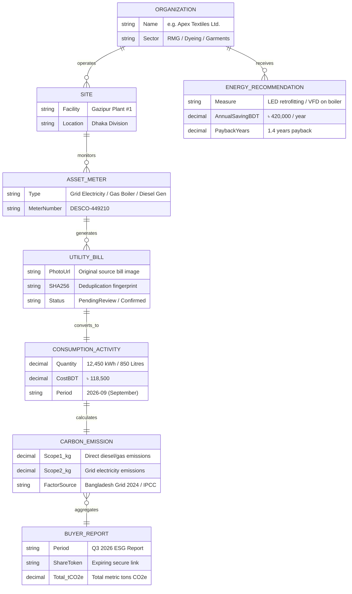
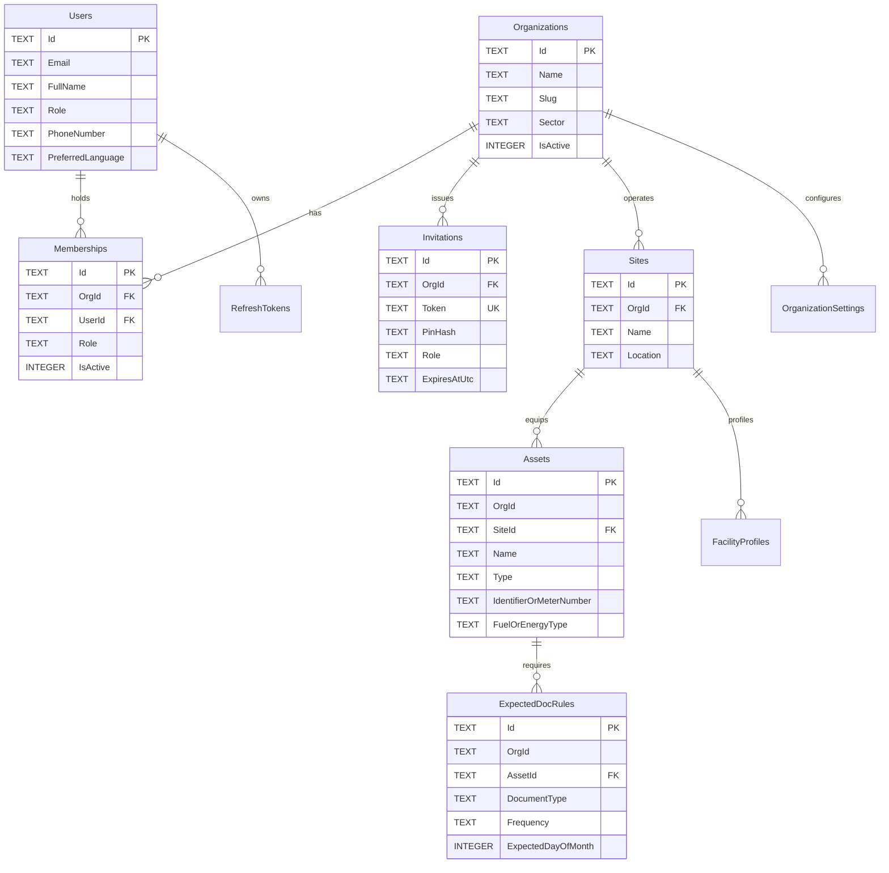
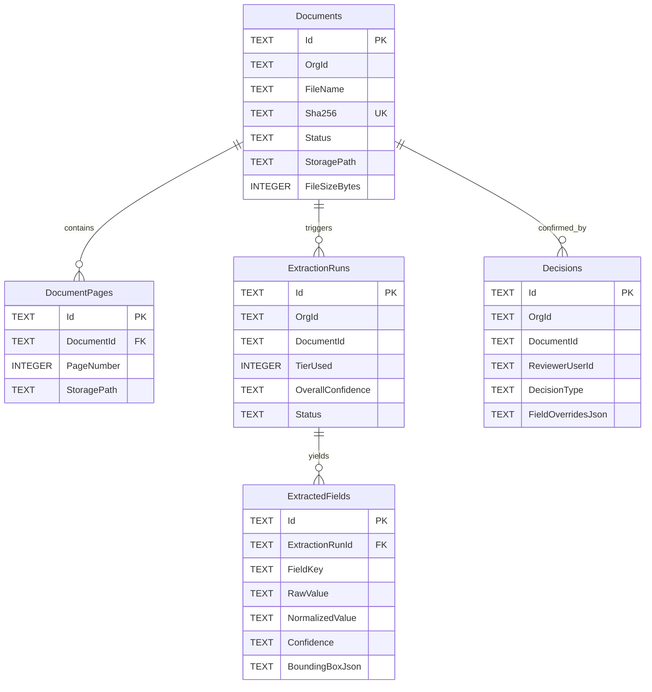
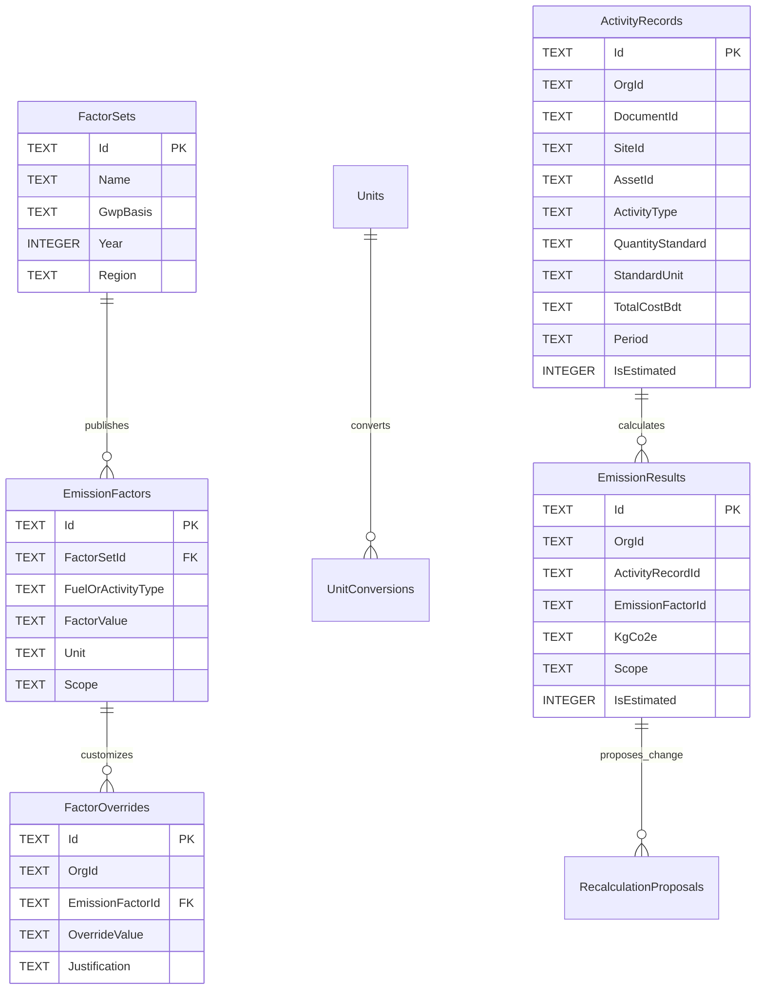
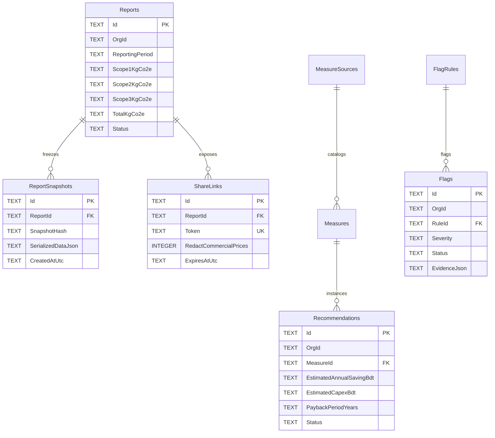

# CarbonBill: Entity Relationship Diagram (ERD)

> **Storage Engine:** SQLite 3 (WAL Mode)  
> **Multi-Tenancy:** Row-level isolation via EF Core Global Query Filter on `OrgId`  
> **Scope:** Full platform data model for SME carbon accounting and buyer reporting

---

## 1. Simplified Core ERD (The 7 Pillars)

High-level stakeholder view of the fundamental entities that power the platform from bill ingestion to verified buyer report:

---

## 2. Complete Domain-by-Domain Modular ERD

Because CarbonBill is built as a **Modular Monolith**, hard database foreign keys are strictly enforced within modules, while cross-module boundaries communicate through logical identifiers (`Guid`).

### 2.1 Identity, Tenancy & Factory Onboarding

---

### 2.2 Documents, Extraction & Human Review

---

### 2.3 Activity Records, Emission Factors & Calculations

---

### 2.4 Reports, Flags, Benchmarks & Recommendations

