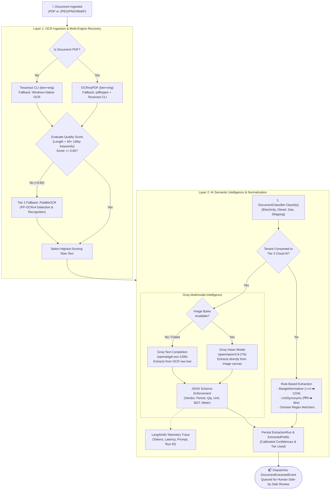
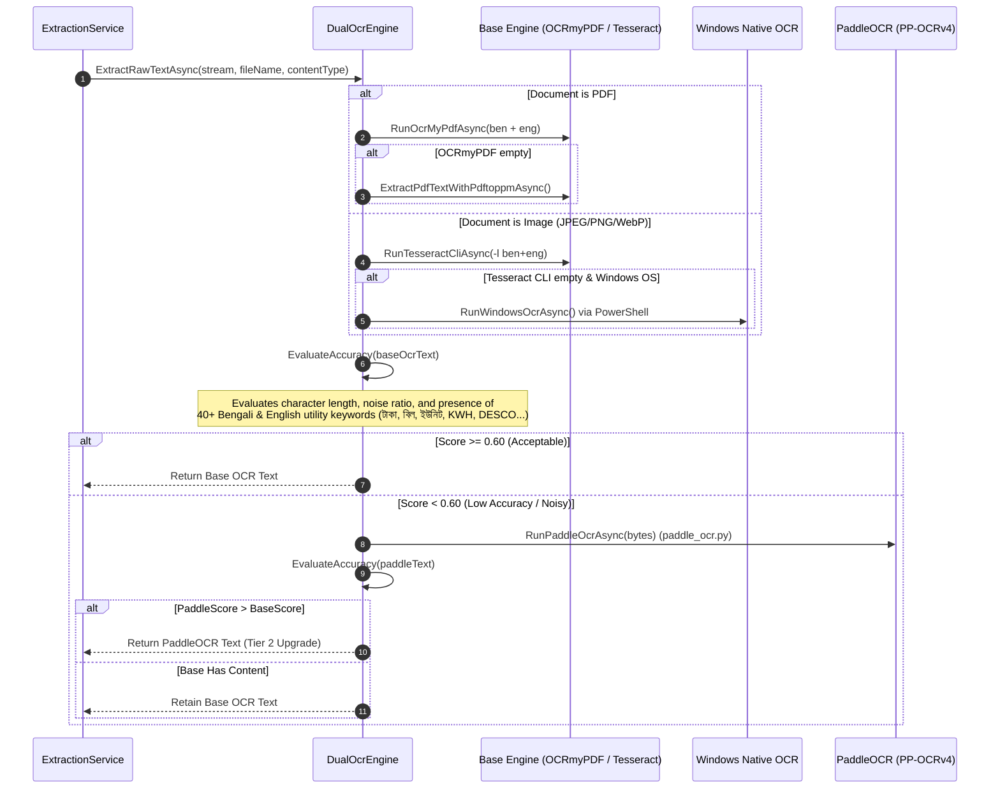
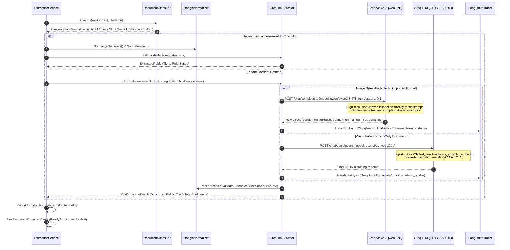

# CarbonBill: OCR & AI Workflow Specification

> **Module Ownership:** `CarbonBill.Modules.Extraction`  
> **Key Services:** [`ExtractionService`](file:///e:/Hackathons/Hack%20for%20Humanity/CarbonBill/src/CarbonBill.Modules.Extraction/Services/ExtractionService.cs), [`DualOcrEngine`](file:///e:/Hackathons/Hack%20for%20Humanity/CarbonBill/src/CarbonBill.Modules.Extraction/Services/Providers/DualOcrEngine.cs), [`DocumentClassifier`](file:///e:/Hackathons/Hack%20for%20Humanity/CarbonBill/src/CarbonBill.Modules.Extraction/Services/Classification/DocumentClassifier.cs), [`GroqLlmExtractor`](file:///e:/Hackathons/Hack%20for%20Humanity/CarbonBill/src/CarbonBill.Modules.Extraction/Services/Groq/GroqLlmExtractor.cs), [`BanglaNormalizer`](file:///e:/Hackathons/Hack%20for%20Humanity/CarbonBill/src/CarbonBill.Modules.Extraction/Services/Normalization/BanglaNormalizer.cs), and [`LangSmithTracer`](file:///e:/Hackathons/Hack%20for%20Humanity/CarbonBill/src/CarbonBill.Modules.Extraction/Services/Tracing/LangSmithTracer.cs).

---

## 1. Unified Pipeline Architecture

The extraction subsystem consists of two complementary layers:
1. **The OCR Workflow:** Ingests raw document binaries (PDF or image) and recovers high-quality raw text across Bengali and English scripts using automated multi-engine fallback and scoring heuristics.
2. **The AI Semantic Workflow:** Ingests the raw image bytes and OCR text, classifies document type, extracts domain entities (quantities, units, meter numbers, financial penalties) via Vision LLMs, normalizes Bengali numerals/units, logs telemetry traces to LangSmith, and hands off to the human review workspace.

---

## 2. Detailed OCR Workflow

Implemented in [`DualOcrEngine.cs`](file:///e:/Hackathons/Hack%20for%20Humanity/CarbonBill/src/CarbonBill.Modules.Extraction/Services/Providers/DualOcrEngine.cs).

### OCR Engine Capabilities & Fallbacks

| Tier / Engine | Target Formats | Languages | Execution Method | Strengths |
|---|---|---|---|---|
| **Tier 1 (Base PDF)** | `.pdf` | `ben` + `eng` | `ocrmypdf` CLI / `pdftoppm` | Generates searchable PDF text layers, preserves multi-page structure. |
| **Tier 1 (Base Image)** | `.jpg`, `.png`, `.webp` | `ben` + `eng` | `tesseract` CLI | Ultra-fast local execution, $0 cost, zero data egress. |
| **Windows Native Fallback** | Images on Windows | System Language Pack | `Windows.Media.Ocr.OcrEngine` | Hardware-accelerated native Windows optical reader. |
| **Tier 2 (PaddleOCR)** | Low-confidence images/PDFs | Latin + CJK/Multilingual | Python `paddleocr` (PP-OCRv4) | Exceptional line detection on faded carbon copies, low-contrast stamps, and skewed paper bills. |

### Accuracy Evaluation Heuristic (`EvaluateAccuracy`)
- **Minimum Length Threshold:** Text $<35$ characters receives an immediate score of $0.15$.
- **Utility Domain Keyword Density:** Matches against 40+ curated Bengali and English terms:
  - *Bengali:* `টাকা`, `বিল`, `ইউনিট`, `মিটার`, `কিলোওয়াট`, `লিটার`, `গ্যাস`, `ডিজেল`, `চালান`, `ডেসকো`, `ডিপিডিসি`, `তিতাস`, `বাখরাবাদ`, `পদ্মা`, `মেঘনা`, etc.
  - *English:* `kwh`, `meter`, `dpdc`, `desco`, `bpdb`, `breb`, `titas`, `diesel`, `litre`, `amount`, `vat`, `challan`, `balance`, `reading`, etc.
- **Scoring Formula:**
  $$\text{Score} = \text{Clamp}\left(0.15 + \min\left(\frac{\text{matchedKeywords}}{4}, 1.0\right) \times 0.65 + \min\left(\frac{\text{length}}{200}, 1.0\right) \times 0.20, 0.0, 1.0\right)$$
- If $\text{Score} \ge 0.60$, the output is accepted. Otherwise, it triggers Tier 2 PaddleOCR.

---

## 3. Detailed AI Semantic Extraction Workflow

Implemented in [`GroqLlmExtractor.cs`](file:///e:/Hackathons/Hack%20for%20Humanity/CarbonBill/src/CarbonBill.Modules.Extraction/Services/Groq/GroqLlmExtractor.cs), [`DocumentClassifier.cs`](file:///e:/Hackathons/Hack%20for%20Humanity/CarbonBill/src/CarbonBill.Modules.Extraction/Services/Classification/DocumentClassifier.cs), and [`BanglaNormalizer.cs`](file:///e:/Hackathons/Hack%20for%20Humanity/CarbonBill/src/CarbonBill.Modules.Extraction/Services/Normalization/BanglaNormalizer.cs).

### 1. Document Classification ([`DocumentClassifier`](file:///e:/Hackathons/Hack%20for%20Humanity/CarbonBill/src/CarbonBill.Modules.Extraction/Services/Classification/DocumentClassifier.cs))
Before LLM invocation, text is classified to prime the system prompt and assign metadata:
- **`ElectricityBill` (0.95 confidence):** Triggered by BPDB, DESCO, DPDC, BREB, NESCO, WZPDCL, Palli Bidyut, KWH, Sanctioned Load, Power Factor, Consumed Unit.
- **`DieselSlip` (0.95 confidence):** Triggered by Diesel, Octane, Petrol, Padma Oil, Meghna Petroleum, Jamuna Oil, Fuel Slip, Generator Fuel.
- **`GasBill` (0.95 confidence):** Triggered by Titas, Bakhrabad, Karnaphuli, Jalalabad, PGCL, SGCL, RMS, Cubic Meter, $m^3$.
- **`ShippingChallan` (0.90 confidence):** Triggered by Challan, Transport, Truck, Cargo, Freight, Tonne-km.

### 2. Multi-Modal Vision LLM (`qwen/qwen3.8-27b`)
- **Direct Image Understanding:** Operates on the original image bytes formatted as a base64 Data URL, bypassing OCR text corruption for handwritten receipts, folded paper, carbon copies, and skewed stamps.
- **Calibrated Field Confidence Scoring:** Rather than returning a static $0.95$ score, the model produces individual, honest field confidence ratings:
  - $0.90 - 0.99$: Crisp digital scan with 100% unambiguous numbers.
  - $0.75 - 0.89$: Clear, readable despite slight crease or glare.
  - $0.50 - 0.74$: Carbon copy slip, messy handwriting, or inferred values.
  - $< 0.50$: Degraded or uncertain reading.

### 3. Bengali Normalization & Synonyms ([`BanglaNormalizer`](file:///e:/Hackathons/Hack%20for%20Humanity/CarbonBill/src/CarbonBill.Modules.Extraction/Services/Normalization/BanglaNormalizer.cs))
Ensures all extracted text maps into deterministic, mathematical values:
- **Numeral Transformation:** All Eastern Arabic / Bengali numerals are mapped to standard ASCII Latin digits:
  $$\text{০}\to 0,\; \text{১}\to 1,\; \text{২}\to 2,\; \text{৩}\to 3,\; \text{৪}\to 4,\; \text{৫}\to 5,\; \text{৬}\to 6,\; \text{৭}\to 7,\; \text{৮}\to 8,\; \text{৯}\to 9$$
- **Canonical Unit Canonicalization:**
  - Electricity: `কেডব্লিউএইচ`, `কিলোওয়াট`, `ইউনিট`, `kw-h`, `units` $\longrightarrow$ `kWh`
  - Liquid Fuel: `লিটার`, `লিঃ`, `লি`, `ltr`, `liter` $\longrightarrow$ `litre`
  - Natural Gas: `ঘনমিটার`, `cum`, `cu.m`, `cubic meter` $\longrightarrow$ `m3`
  - Solid Fuel / Cargo: `কেজি`, `কিলোগ্রাম`, `kgs` $\longrightarrow$ `kg`

### 4. Telemetry & Tracing ([`LangSmithTracer`](file:///e:/Hackathons/Hack%20for%20Humanity/CarbonBill/src/CarbonBill.Modules.Extraction/Services/Tracing/LangSmithTracer.cs))
All LLM inferences emit asynchronous telemetry to LangSmith under the `CarbonBill` project:
- Model name and prompt versioning.
- Execution latency in milliseconds.
- Input file metadata (file name, MIME type, file size).
- Extracted JSON output and field confidences.
- HTTP error statuses and fallback escalation tracking.

---

## 4. Human-in-the-Loop Review Handoff

The AI extraction never silently mutates production carbon balances. It serves as an assistive copilot for the factory accountant:

1. The extracted fields are stored in the database with their respective bounding boxes and confidence flags.
2. If any critical field has a confidence score $< 0.75$, the accountant workspace highlights the field with an amber warning badge.
3. The accountant verifies the extracted figures side-by-side with the high-resolution original document.
4. Only upon clicking **"Confirm & Sign Off"** is the record converted into an `ActivityRecord` and forwarded to the calculation engine.
