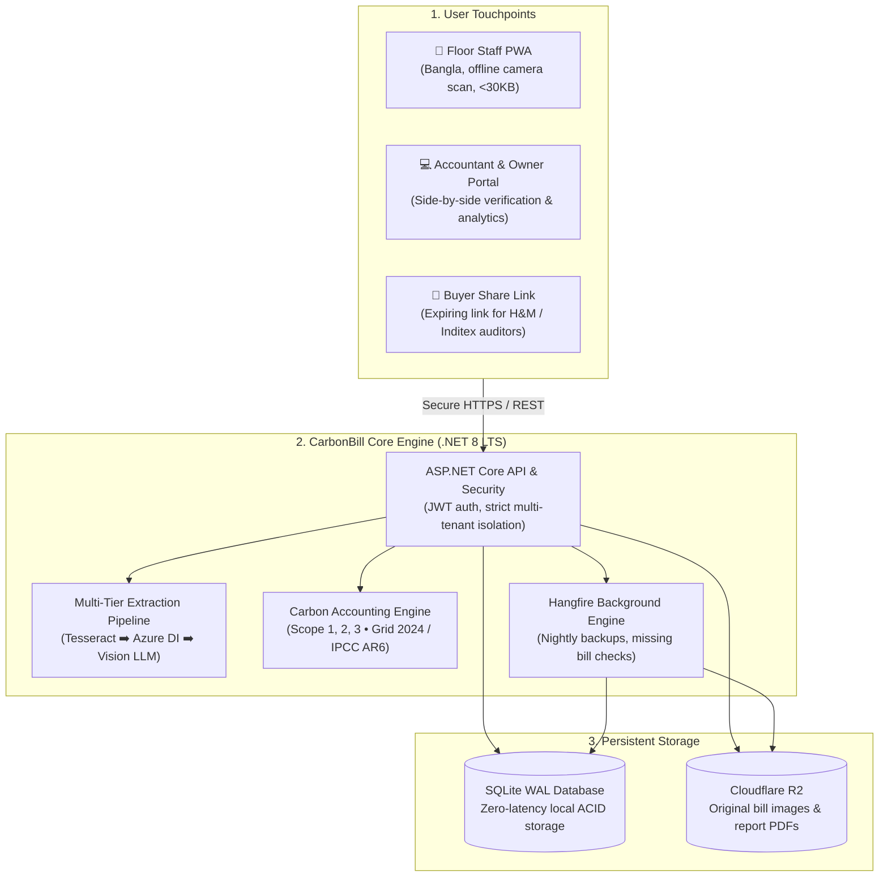
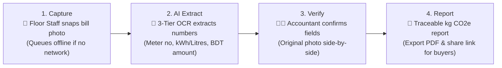
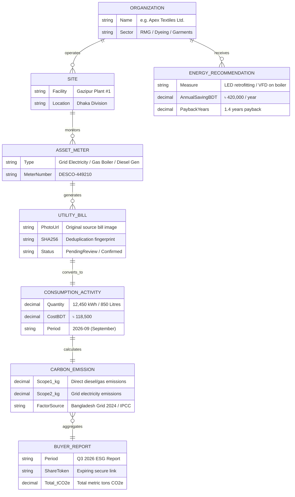

# CarbonBill: Project Update & Architecture Brief

> **One-Liner:** Bangla-first SME carbon-accounting platform converting factory utility bills into verified, audit-defensible GHG buyer reports with human-in-the-loop AI extraction.

---

## 1. Simplified System Architecture (3-Tier View)

Designed to work reliably over 2G/3G factory networks in Bangladesh while delivering enterprise-grade compliance for global fashion brands.

---

## 2. End-to-End Bill Journey (4-Step Pipeline)

How an electricity, gas, or diesel bill travels from a factory floor in Gazipur to an ESG audit report in Europe:

### The 4 Stages Explained:
1. **Capture (Jahid - Floor Staff):** Snaps a photo of the bill using the mobile PWA. If internet drops, it saves securely to IndexedDB and syncs automatically when reconnected.
2. **AI Extract (Automated):** Free local OCR reads printed text first; escalates to vision LLMs (Groq / Qwen) only for challenging handwritten receipts.
3. **Verify (Rahim - Accountant):** Trust before automation. The accountant reviews the original photo side-by-side with extracted values and signs off.
4. **Report (Kabir & Nusrat - Owner & Compliance):** System matches consumption with official national emission factors to calculate verified Scope 1 & 2 carbon footprints.

---

## 3. Simplified Core Data Model (The 7 Pillars)

Instead of the full 41-table internal database, this simplified model shows the 7 fundamental entities that power the platform:

---

## 4. Key Highlights for Project Updates

### 💡 Why This Design Wins
- **Bangla-First Floor Experience:** Built specifically for factory workers with minimal tech literacy; ultra-lightweight (<30 KB initial JavaScript load).
- **Zero Hallucination Risk:** Numbers are never committed to ESG reports without explicit accountant confirmation against the original photo.
- **Cost-Resilient Architecture:** Operates with $0 cloud infrastructure fees during pilot testing using SQLite WAL mode, local Tesseract OCR, and Cloudflare free tier.
- **Traceable to the Exact Meter:** Every carbon number in a buyer's PDF links directly back to the original utility invoice, factor source, and reviewer timestamp.
- **High Throughput & Speed:** Backend built on .NET 8 LTS with 174 passing automated tests ensuring 100% tenant data isolation and mathematical precision.
