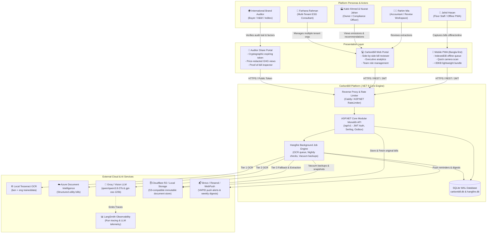
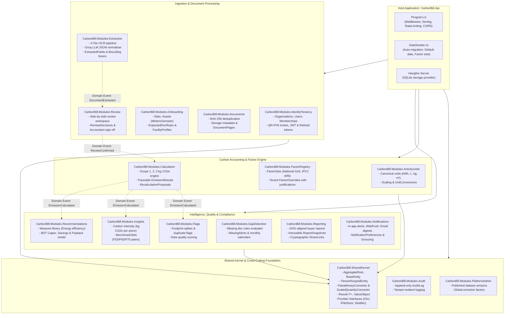
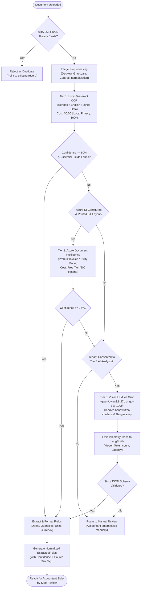
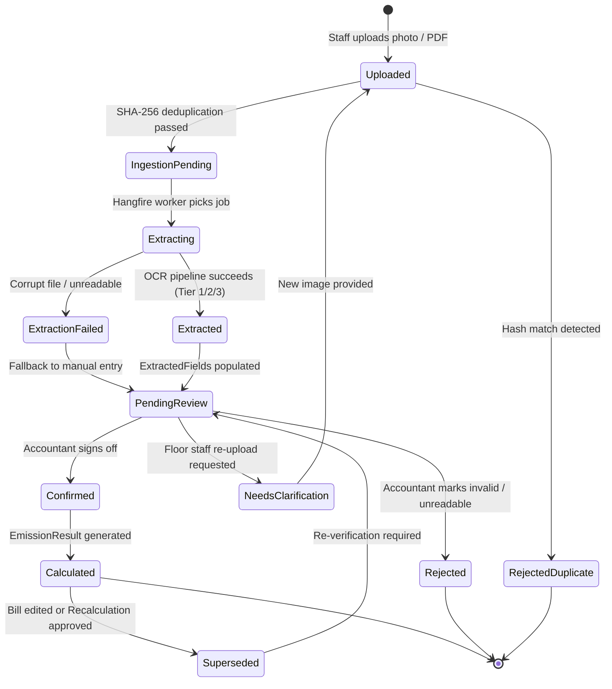
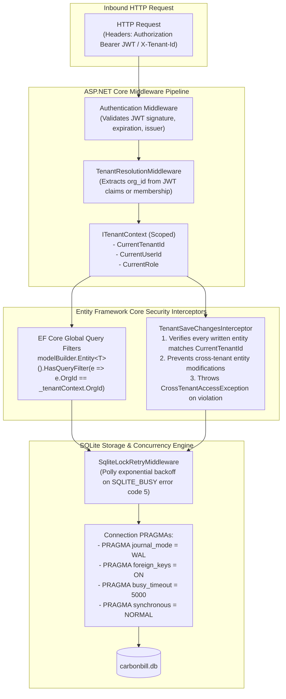
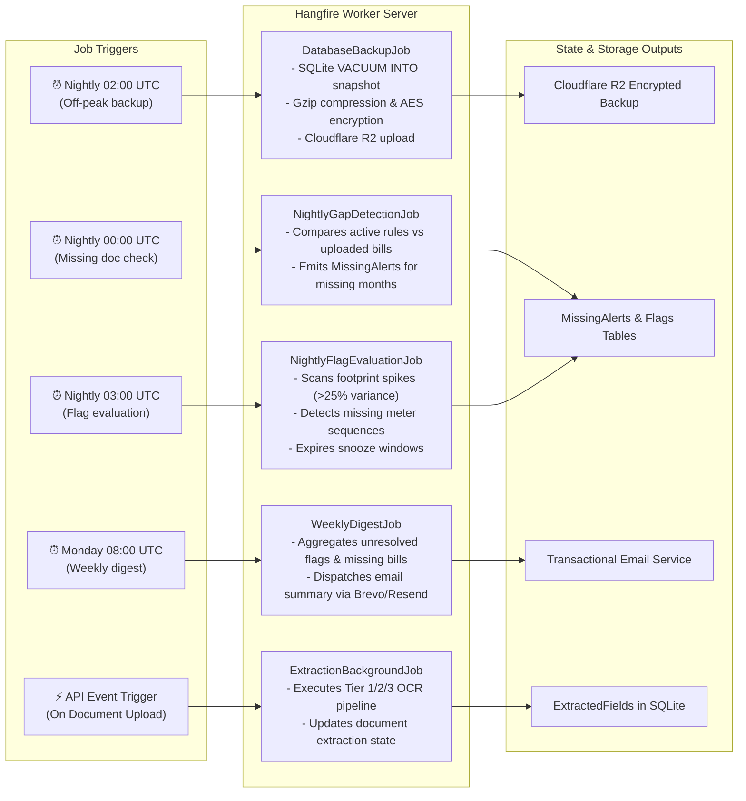
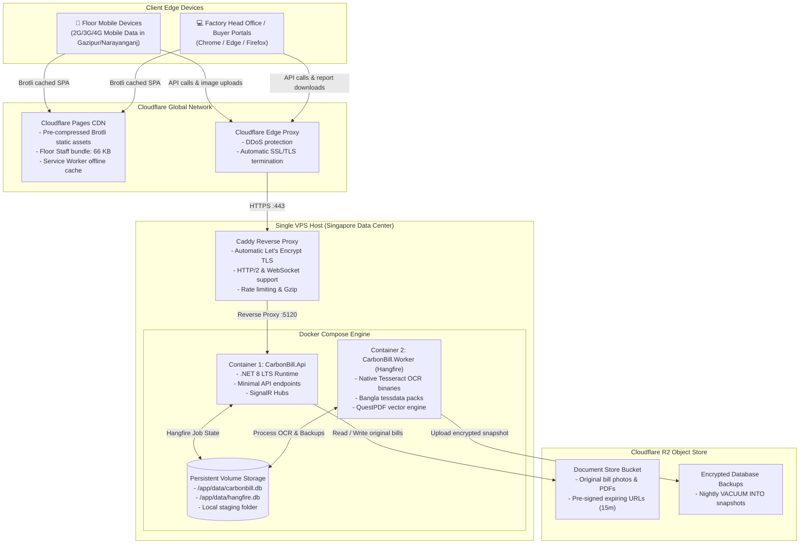

# CarbonBill: System Architecture & Design Diagrams

> **Platform Edition:** .NET 8 LTS (ASP.NET Core Minimal APIs) + SQLite WAL + Hangfire + React Vite PWA  
> **Target Sector:** Bangladesh RMG / Textile / Manufacturing SME Carbon Accounting & Buyer Verification

---

## 1. High-Level System Context (C4 Level 1)

This diagram illustrates how all user personas, client interfaces, core backend services, and external integrations communicate across trust boundaries.



---

## 2. Modular Monolith Component Architecture (C4 Level 2)

CarbonBill is engineered as a **Modular Monolith** with zero circular dependencies, strict NetArchTest boundaries, and isolated EF Core DbContexts sharing a single SQLite connection pool.



---

## 3. End-to-End Bill Processing & Carbon Accounting Pipeline

The lifecycle of an energy bill: from mobile capture on the factory floor to international buyer verification.

```mermaid
sequenceDiagram
    autonumber
    actor Floor as 👷 Floor Staff (Jahid)
    actor Acct as 🧑‍💼 Accountant (Rahim)
    participant PWA as 📱 React PWA
    participant API as 🌐 CarbonBill.Api
    participant Store as 🗄️ FileStore (R2/Local)
    participant Queue as ⚡ Hangfire Job Queue
    participant OCR as 🧠 Extraction Engine (Groq / Vision)
    participant Calc as 🔢 Calculation Engine
    participant Flags as 🚩 Flag & Audit Engine
    actor Buyer as 🌍 Brand Auditor

    Floor->>PWA: Capture utility bill photo (Gas / DESCO / Diesel)
    Note over Floor,PWA: Stored in IndexedDB if offline; auto-syncs when online
    PWA->>API: POST /api/v1/documents (multipart/form-data)
    API->>API: Compute SHA-256 hash (deduplication check)
    API->>Store: Save original bill image
    API->>Queue: Enqueue ExtractionJob(documentId)
    API-->>PWA: 202 Accepted (DocumentId, Status: Uploaded)

    Queue->>OCR: Execute Multi-Tier OCR & LLM Parsing
    OCR->>OCR: Extract vendor, billing period, units, amount, meter no
    OCR-->>API: Store ExtractedFields & Confidence Scores
    API->>API: Update Status: PendingReview

    Acct->>PWA: Open Review Workspace (/review)
    PWA->>API: GET /api/v1/review/{documentId}
    API-->>PWA: Return original bill image URL + ExtractedFields side-by-side
    Acct->>PWA: Verify fields, correct meter reading, click "Confirm"
    PWA->>API: POST /api/v1/review/{documentId}/confirm
    API->>API: Store ReviewDecision & Append-Only AuditLog

    API->>Calc: Trigger ActivityRecord & Emission Calculation
    Calc->>Calc: Convert raw unit to Canonical Unit (kWh, L, kg)
    Calc->>Calc: Lookup Active Emission Factor (Grid 2024 / DEFRA)
    Calc->>Calc: Calculate kg CO2e = Quantity * FactorValue
    Calc-->>API: Save EmissionResult (Linked to Document & Reviewer)

    API->>Flags: Run Quality & Anomaly Checks
    Flags->>Flags: Check spikes vs rolling 3-month baseline & missing gaps
    Flags-->>API: Persist Flags & Recalculate Data Quality Score

    Acct->>API: POST /api/v1/reports/generate (Scope 1 & 2 Snapshot)
    API->>API: Create Immutable ReportSnapshot + Cryptographic ShareToken
    API-->>Acct: ShareLink generated

    Buyer->>API: GET /share/{token}
    API-->>Buyer: Interactive Buyer Audit Portal (Full provenance down to source bill)
```

---

## 4. Multi-Tier OCR Fallback & Extraction Strategy

CarbonBill balances cost, speed, local privacy, and handwriting capability through a 3-tier escalation strategy.



---

## 5. Document & Review State Machine

Tracks document states throughout ingestion, OCR, accountant verification, and recalculations.



---

## 6. Multi-Tenant Security & Code-Level Isolation Architecture

SQLite lacks native PostgreSQL Row-Level Security (RLS). CarbonBill enforces multi-tenant defense-in-depth across the application and data layers.



---

## 7. Asynchronous Hangfire Job Orchestration

Diagram of scheduled cron routines and transactional background tasks.



---

## 8. Production Infrastructure & Deployment Topology

Low-latency deployment configuration optimized for Bangladesh (<60ms roundtrip to Dhaka).


